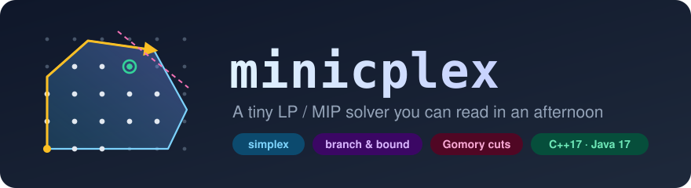

<h3>关于 minicplex</h3>

<a href="README.md">README（使用说明）</a> ·
<b>关于（About）</b> ·
<a href="docs/PRD.md">产品需求文档</a> ·
<a href="CHANGELOG.md">更新日志</a> ·
<a href="CONTRIBUTING.md">参与贡献</a>

> **README 讲“怎么用”，这一页讲“为什么”。**
> 这里写的是 minicplex 的来历、想法、取舍、走过的路，以及接下来想去哪里。
> 想马上跑起来，请看 [README 的“30 秒上手”](README.md#30-秒上手)。

---

## 目录

- [一句话介绍](#一句话介绍)
- [为什么要写它](#为什么要写它)
- [它是什么，不是什么](#它是什么不是什么)
- [四条设计原则](#四条设计原则)
- [适合谁](#适合谁)
- [一路走来](#一路走来)
- [数字一览](#数字一览)
- [怎么保证算得对](#怎么保证算得对)
- [路上的意外收获](#路上的意外收获)
- [诚实地说：它的局限](#诚实地说它的局限)
- [接下来去哪里](#接下来去哪里)
- [常见问题](#常见问题)
- [致谢](#致谢)
- [作者与许可证](#作者与许可证)

---

## 一句话介绍

**minicplex 是一个从零写成、零依赖、每一步都看得见的线性规划 / 混合整数规划求解器**，
主版本用 C++17，另有逐行移植的 Java 17 版和纯 Python 版；同时它也是一套中文 **Java 课**和 **Python 课**的教材。

名字里的 “mini” 是说它小：C++ 核心代码约 2,300 行，一个下午就能从 `main` 读到分支定界；
“cplex” 是向 IBM ILOG CPLEX 致敬：它读写 CPLEX 的 `.lp` 文件，打印 CPLEX 风格的节点日志，建模 API 也仿照 CPLEX 的 Concert。

## 为什么要写它

**1. 想从内部看懂求解器。**
CPLEX、Gurobi 这样的商业求解器是运筹优化的核心工具：排班、物流、生产计划、投资组合，背后都是它们。
可是对使用者来说，它们是一个黑盒：给它一个模型，它还你一个答案，中间发生了什么，你看不到。
教科书会讲单纯形法和分支定界，但“书上的算法”和“真正能跑题目的程序”之间，隔着一大片没人讲的细节：
退化循环怎么防、舍入误差怎么控制、子问题怎么热启动、什么时候可以放心剪枝……

**2. 现有的开源求解器太大，不适合入门。**
HiGHS、CBC、SCIP 都很优秀，但动辄几万到几十万行代码，新手很难找到入口。
市面上缺一个“几千行以内、真能解题、还讲得清楚”的教学型求解器。

**3. 工作上用得着。**
作者是决策自动化（业务规则、ODM）方向的产品经理。真正理解优化求解器怎么工作，
才能判断产品方向，和客户、工程团队讲清楚“规则引擎和优化引擎怎么配合”。
与其读十篇介绍，不如亲手写一个。

**4. 顺便把编程也教了。**
写到后来发现：一个真实、完整、注释详细的项目，本身就是很好的编程教材。
于是有了用求解器源码讲 Java 和 Python 的两门课，让从没写过代码的人，也能从打印第一行字，一路学到读懂这个求解器。

## 它是什么，不是什么

| ✅ 它是 | ❌ 它不是 |
|---|---|
| 一个**真能解题**的 LP / MIP 求解器，结果和 HiGHS、OR-Tools 逐题核对过 | CPLEX 的替代品，也和 IBM 没有任何关系 |
| 一份**可以从头读到尾**的教材，代码短、注释多，`--trace` 用中文打印每一步 | 追求速度的工业级求解器（它用稠密单纯形表，适合几百行 / 几百列） |
| 一个可以**嵌进小项目**的零依赖库（C++ / Java / Python 任选） | 二次规划（QP）、二阶锥（SOCP）、约束规划（CP）求解器 |
| 一套**从零开始**的中文 Java 课和 Python 课 | 图形界面工具，也不做商业化 |

## 四条设计原则

**① 好读比快更重要。**
每个算法集中在少数几个文件里；宁可多写一行注释解释“为什么”，也不写聪明但难懂的代码。
代码解析逐个函数讲到底，[README 的“代码解析”](README.md#代码解析)一节就是一份完整的导读。

**② 算得对比好读更重要。**
自己写的求解器，最怕“看起来能跑，其实算错了”。所以每一次提交都要过对拍、暴力枚举、内存检查三道关（见[下文](#怎么保证算得对)）。
接受一个整数解之前，还要用原始矩阵重新严格核对一遍（解抛光），不让舍入误差蒙混过关。

**③ 每一步都看得见。**
加上 `--trace`，就能看到谁进基、谁离基、为什么剪枝、为什么选这个变量分支、每个割平面是怎么来的。
求解器不该是黑盒，至少这一个不是。

**④ 三种语言，一模一样。**
Java 版和 Python 版不是“参考 C++ 重写”，而是**逐行移植**：同一道题，三边的节点数、迭代次数、每一行 trace 完全相同。
CI 每次提交都逐题核对，任何一处不同都会失败。这样你可以用最熟悉的语言读代码，读到的就是同一个算法。

## 适合谁

| 你是…… | 你可以…… |
|---|---|
| 学运筹优化的学生 / 工程师 | 单步跟踪单纯形和分支定界，把教科书上的每个概念对应到具体代码 |
| 产品经理 / 售前 / 讲师 | 用面包店、选项目、排班这些小例子，讲清楚“优化求解器是什么、怎么建模” |
| 开发者 | 在没有商业许可证的环境里，给小项目嵌一个轻量求解器 |
| 想学 Java 的人 | 从 [Java 课](java/tutorial/README.md)的 A1 开始，20 节，每节一道自动判分的练习 |
| 想学 Python 的人 | 打开[网页版 Python 课](https://xudaniel.github.io/minicplex/python/)，不用安装；27 节，另有英文版 |
| 完全没接触过优化的人 | 先读 README 的[“用大白话讲 minicplex”](README.md#用大白话讲-minicplex先看这里)，不需要数学和编程基础 |

## 一路走来

| 阶段 | 做了什么 |
|---|---|
| **v0.1** | 两阶段单纯形、分支定界、CPLEX LP 文件读写、命令行、测试；500 道随机整数题与暴力枚举 500/500 一致 |
| **v1.0**（2026-11-19 发布） | 有界变量单纯形、对偶单纯形热启动、下潜式分支定界；CI、Sanitizer、与 HiGHS 对拍、基准测试一应俱全。单纯形迭代减少 95%，总用时快约 4.5 倍 |
| **整数规划提速** | 可靠性分支、根节点 Gomory 混合整数割、预处理：评测集节点少 28%，生产排程例子从 7,001 个节点降到 419 个 |
| **影子价格与进阶建模** | 输出对偶值和既约成本（`--duals`）；新增固定费用、最小化最大值、绝对值、不可行诊断等进阶例子和建模技巧速查表 |
| **第二个标准答案** | 与 Google OR-Tools（GLOP / SCIP）对拍 1,030 道题，全部一致 |
| **Java 版** | 整个求解器逐行移植到 Java 17，零依赖；移植过程中发现并修复了 C++ 版两个“搜索路径不确定”的问题 |
| **Java 课** | 12 节正式课 + 8 节零基础入门，例子全部取自求解器源码 |
| **Python 版** | 逐行移植到纯 Python（只用标准库），与 C++ 逐位一致，连 `-0.0` 的符号都对得上 |
| **Python 课** | 8 节零基础 + 12 节正式课 + 7 节进阶，共 27 节；常见错误自动说明、分级提示、“先猜后跑”练习 |
| **网页版 Python 课** | 课文、编辑器、判分在同一页，Python 在浏览器里运行，手机也能学；每次发布前先在真浏览器里把每一课跑一遍 |
| **英文版 Python 课** | 全部课程译成英文，网页右上角一键切换中英文 |

详细记录见 [CHANGELOG.md](CHANGELOG.md)，每个版本的需求和验收结果见 [PRD](docs/PRD.md)。

## 数字一览

| | |
|---|---|
| C++ 核心代码 | 约 2,300 行（`src/` + `include/`），零第三方依赖 |
| 语言版本 | C++17 / Java 17+ / Python 3.9+，计算路径完全相同 |
| 例子 | 每种语言 15 个：10 个入门与进阶建模 + 面包店、选项目、生产排程、员工排班、API 演示 |
| 课程 | Java 课 20 节、Python 课 27 节（中英双语），每节一道自动判分练习 |
| 与 HiGHS 对拍 | v1.0 约 6,000 道、v1.1 约 4,000 道随机题全部一致；CI 每次提交再换种子对拍 500 道 |
| 与 OR-Tools 对拍 | 1,030 道随机题全部一致 |
| 速度 | 13 个基准模型总用时：v0.1 的 2.78 秒 → 现在约 0.3 秒（C++） |

## 怎么保证算得对

每一次提交，GitHub Actions 都会自动做这些事：

1. **编译和测试**：Linux 和 macOS 各跑一遍单元测试、例子和命令行冒烟测试。
2. **内存检查**：用 AddressSanitizer + UBSan 再跑一遍，抓越界和未定义行为。
3. **与 HiGHS 对拍**：随机生成 500 道混合整数题，逐题对比结论和目标值；HiGHS 自己出错时，换暴力枚举当裁判。
4. **基准对比**：13 个基准模型的结果一旦变化就失败，速度变化打印出来供人判断。
5. **三语言一致**：Java 版（JDK 17 / 21）和 Python 版（3.9 / 3.13）逐题对比节点数和迭代次数，例子输出逐字对比。
6. **课程**：两门课的全部参考答案都要跑通；网页版发布前在无头浏览器里把中英文每一课都跑一遍。

还有几项专门的测试：小题暴力枚举所有整数点核对最优值；每个 Gomory 割对所有整数可行点逐一检验有效性；
影子价格用“把右端项挪一点点，看目标变多少”的扰动法核对。

## 路上的意外收获

写一个“小”求解器，却抓到了不少真问题，这也是这个项目最有意思的部分：

- **HiGHS 的一个错误**：一道 LP 松弛无界的整数规划，HiGHS 报“最优 41”，实际上目标可以沿一条射线无限下降；minicplex 正确地报告“不可行或无界”。
- **OR-Tools 的一个坑**：OR-Tools 的 MPSolver 没有“不可行或无界”这个状态，会把 GLOP 的这种结论直接报成“不可行”；500 道题里有 69 道受影响。读源码确认后写进了[对拍记录](docs/ortools-comparison.md)。
- **自己的 bug（对拍抓到的）**：单纯形表的舍入误差累积，曾让求解器接受一个违反约束 3×10⁻⁵ 的“伪解”。修复方法是按原始矩阵复核 + 解抛光。
- **自己的 bug（移植抓到的）**：两个效力完全相同的割，选哪个取决于标准库的排序实现；新编译器还会悄悄把 `a*b+c` 合成 FMA 指令，舍入不同导致搜索路径不同。改成稳定排序和 `-ffp-contract=off` 之后，任何编译器、任何 CPU 上都走同一条路。
- **自己的 bug（写课程抓到的）**：Java 版 `LinExpr.terms()` 直接把内部 `TreeMap` 交了出去，外面可以改动一个“不可变”的表达式。为了给学生讲“不可变对象”，先把自己的代码修好了。

> 一个启示：**看到“不可行”不要急着下结论**，先问清楚是哪一层、在什么设置下得出的。minicplex 自己区分了 `Infeasible` 和 `InfeasibleOrUnbounded`，在这一点上比很多大求解器的接口更诚实。

## 诚实地说：它的局限

| 局限 | 原因 | 计划 |
|---|---|---|
| 只适合中小模型（几百行 / 几百列） | 用的是稠密单纯形表，代码短、好读，但每次换基 O(m·(n+m)) | v2.0 改为修正单纯形 + 稀疏 LU 分解 |
| Python 版比 C++ 慢很多（基准模型约 20 秒 vs 约 0.4 秒） | 纯 Python、只用标准库 | 它的定位是教学和中小模型；要速度请用 C++ 版 |
| 割平面只在根节点加 | 根节点的割全局有效，实现简单 | 计划加覆盖割和树内割平面 |
| 整数变量无界时，可能证明不完最优 | 没有专门处理无界整数方向 | 已记录为已知局限；通常早已找到最优解，最终状态是 NodeLimit |
| 不读 MPS 文件、不输出解文件 | 还没来得及做 | 在路线图上 |

更多取舍见 README 的[“设计取舍与局限”](README.md#9-设计取舍与局限)。

## 接下来去哪里

- **v1.1 收尾**：MPS 文件读取、解文件输出、范围约束（`-2 <= x + y <= 5`）。
- **v1.2**：覆盖割和树内割平面。
- **v2.0**：修正单纯形 + 稀疏 LU 分解，把规模扩大到上千变量，挑战 MIPLIB 里的小题（如 `p0033`、`flugpl`）。
- **以后**：更强的预处理（如变量替换、对偶推理），修改已有约束 / 删除变量的建模接口。

完整路线图见 [PRD 第 8 节](docs/PRD.md#8-版本路线图)。

## 常见问题

<b>和 IBM CPLEX 是什么关系？</b>

没有关系。minicplex 是一个独立的学习项目，只是读写 CPLEX 的 `.lp` 文件格式、模仿 CPLEX 的日志和建模风格，方便学过 CPLEX 的人上手。名字是致敬，不是授权。

<b>能用在真实业务里吗？</b>

几百个变量以内的小模型可以，而且结果经过大量对拍。但它没有为速度和大规模做优化，正式的生产系统请用 CPLEX、Gurobi、HiGHS、SCIP 这类成熟求解器。minicplex 更适合用来**理解**它们。

<b>为什么要做三种语言？维护起来不累吗？</b>

累，但值得。一是让读者用最熟悉的语言读同一个算法；二是“逐行移植 + 逐步对比”本身就是一种很强的测试，C++ 版好几个隐蔽的不确定性问题都是移植时发现的。CI 每次提交都核对三边，任何分叉都会立刻暴露。

<b>我完全不会编程，能学吗？</b>

能。Java 课和 Python 课都从“让程序打印一行字”开始，每节 10～20 分钟，只学一件事。最省事的是直接打开[网页版 Python 课](https://xudaniel.github.io/minicplex/python/)，什么都不用装，手机上也能做练习。

<b>我不懂数学，能看懂求解器在干什么吗？</b>

可以先读 README 的[“用大白话讲 minicplex”](README.md#用大白话讲-minicplex先看这里)：用面包店做例子，三个比喻讲清楚单纯形法、分支定界和各种加速技巧，还有一张术语对照表。

<b>为什么用稠密单纯形表，而不是更快的稀疏实现？</b>

因为好读。稠密表让比值检验、换基、恢复基都很直接，一眼就能对上教科书；代价是只适合几百行 / 列。稀疏 LU 分解是 v2.0 的目标，到时候会像现在一样，先讲清楚再写进去。

<b>发现算错了，或者看不懂某段代码，怎么办？</b>

欢迎提 issue。算错了请附上能复现的 `.lp` 文件和命令；看不懂也欢迎问，看不懂通常说明注释或文档写得还不够清楚。流程见 [CONTRIBUTING.md](CONTRIBUTING.md)。

## 致谢

- **[HiGHS](https://highs.dev/)**：开源 LP / MIP 求解器，minicplex 的“标准答案”，CI 每次提交都要和它对一遍。
- **[Google OR-Tools](https://developers.google.com/optimization)**（GLOP / SCIP）：第二个标准答案。
- **[Pyodide](https://pyodide.org/)**：让 Python 在浏览器里运行，网页版 Python 课靠它才能“打开就能学”。
- **IBM ILOG CPLEX**：LP 文件格式、节点日志和 Concert 建模风格的灵感来源。
- 每一位读代码、做练习、提问题的人：你们的“看不懂”是这个项目最好的改进清单。

## 作者与许可证

由 **Daniel Xu** 发起和维护，采用 [MIT 许可证](LICENSE)：可以自由使用、修改、分发，包括商业用途。

如果这个项目帮你看懂了一点点求解器，或者帮你写出了人生第一行代码，欢迎点一个 ⭐，也欢迎把它分享给正在学优化或学编程的朋友。

<a href="README.md">← 回到 README</a>

