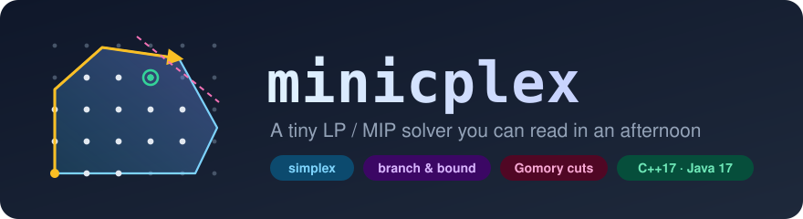
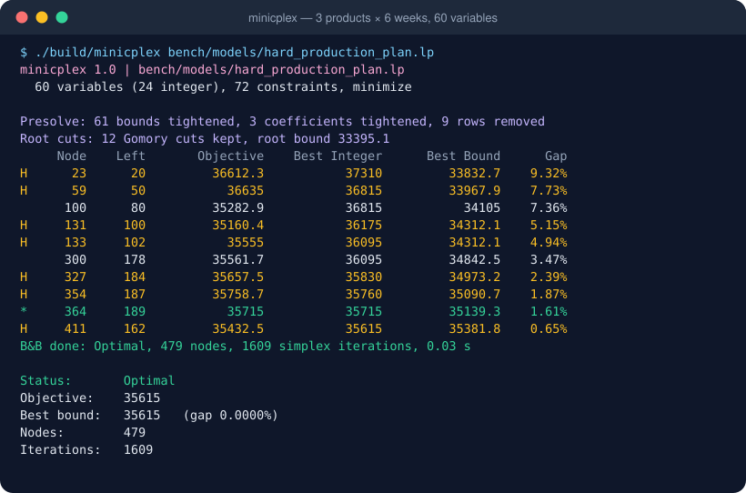
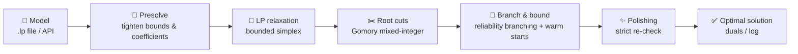

<div align="center">



<h3>A mini CPLEX built from scratch: a linear and mixed-integer programming solver</h3>

<p>
<a href="https://github.com/xudaniel/minicplex/actions/workflows/ci.yml"></a>
<a href="https://github.com/xudaniel/minicplex/releases"></a>


<a href="LICENSE"></a>
</p>

<p>
<b>English</b> · <a href="README.md">简体中文</a>
</p>

<p>
<a href="#quick-start"><b>Quick start</b></a> ·
<a href="#how-it-works">How it works</a> ·
<a href="#examples">Examples</a> ·
<a href="#code-tour">Code tour</a> ·
<a href="#java-version">Java version</a> ·
<a href="docs/PRD.en.md">PRD</a>
</p>

</div>

**minicplex** is a dependency-free LP / MIP solver written in C++17, with a line-by-line Java 17 port. It reads and
writes CPLEX `.lp` files, offers a Concert-style modelling API and prints a CPLEX-style branch-and-bound log. It
was written to understand solvers like IBM ILOG CPLEX **from the inside**: the code is short and heavily commented,
and `--trace` shows every simplex pivot, every cut and every branching decision.

<p align="center"></p>

## Highlights

<table>
<tr>
<td width="50%" valign="top">

**🧮 A complete MIP pipeline**<br>
Bounded-variable simplex, dual simplex warm starts, presolve, Gomory cuts, reliability branching and solution
polishing: the backbone of a modern MIP solver.

</td>
<td width="50%" valign="top">

**🔍 Every step is visible**<br>
`--trace` narrates the solve: which variable enters, which leaves, why a node was pruned, why a variable was
chosen for branching. Good teaching material.

</td>
</tr>
<tr>
<td width="50%" valign="top">

**✅ Fuzzed against reference solvers**<br>
Compared with HiGHS and OR-Tools on more than ten thousand random models with full agreement. Along the way it
caught bugs in HiGHS itself.

</td>
<td width="50%" valign="top">

**☕ C++ and Java, step for step**<br>
The Java port takes exactly the same path: same nodes, same simplex iterations, same `--trace` line for line.
CI checks this on every commit.

</td>
</tr>
<tr>
<td width="50%" valign="top">

**📚 Tutorial-grade examples**<br>
Ten graded examples from "one variable" to elastic constraints, a modelling cheat sheet, exercises, a
function-by-function code walkthrough, and a [Java course](java/tutorial/README.md) (in Chinese): 8 zero-basics lessons plus 12 main lessons.

</td>
<td width="50%" valign="top">

**🪶 Small, readable, zero dependencies**<br>
No third-party libraries. The C++ core is about 2,200 lines, so you can read from `main` to branch-and-bound in an
afternoon.

</td>
</tr>
</table>

> **Language note.** The source code and its comments are in English. The detailed tutorial, the `--trace`
> narration and the comments in the examples are in Chinese; this page summarises them in English.

## Quick start

```bash
git clone https://github.com/xudaniel/minicplex.git && cd minicplex
cmake -S . -B build && cmake --build build -j
./build/minicplex examples/bakery.lp            # solve a small bakery MIP
./build/minicplex examples/bakery.lp --trace    # watch it, step by step
ctest --test-dir build                          # run the test suite
```

`examples/bakery.lp` is a tiny model in CPLEX LP format: a bakery makes cakes (profit 5) and loaves of bread
(profit 4) with 24 kg of flour and 6 hours of labour.

```text
Maximize
 profit: 5 cake + 4 bread
Subject To
 flour: 6 cake + 4 bread <= 24
 labor: cake + 2 bread <= 6
General
 cake bread
End
```

The same model in code:

<table>
<tr><th>C++</th><th>Java</th></tr>
<tr>
<td>

```cpp
Model m;
Var cake  = m.addVar(0, INF, VarType::Integer, "cake");
Var bread = m.addVar(0, INF, VarType::Integer, "bread");
m.addConstr(6 * cake + 4 * bread <= 24, "flour");
m.addConstr(cake + 2 * bread <= 6, "labor");
m.setObjective(5 * cake + 4 * bread,
               ObjSense::Maximize);
Result r = solve(m);   // r.objective == 20
```

</td>
<td>

```java
Model m = new Model();
Var cake  = m.addVar(0, Model.INF, VarType.INTEGER, "cake");
Var bread = m.addVar(0, Model.INF, VarType.INTEGER, "bread");
m.addConstr(LinExpr.of(6, cake).plus(4, bread).le(24), "flour");
m.addConstr(LinExpr.of(cake).plus(2, bread).le(6), "labor");
m.setObjective(LinExpr.of(5, cake).plus(4, bread),
               ObjSense.MAXIMIZE);
Result r = Solver.solve(m);   // r.objective == 20
```

</td>
</tr>
</table>

If half a cake were allowed (an LP), the best plan would be 3 cakes and 1.5 loaves for a profit of 21. With whole
units only (a MIP), the optimum is 4 cakes and no bread, profit 20. Rounding the LP answer down gives only 19, which
is why integer programming needs branch-and-bound.

## How it works



Three ideas carry most of the weight:

1. **Simplex: climbing along the corners.** The constraints carve out a polytope, and an optimal solution always
   sits at a corner. The simplex method walks from corner to better neighbouring corner until none is better.
2. **Branch-and-bound: case analysis plus giving up early.** Solve the relaxation; if a variable is fractional
   (1.5 loaves), split into "bread ≤ 1" and "bread ≥ 2". Whenever a branch's best possible value is no better than
   a solution already found, the whole branch is discarded.
3. **Tricks that make it fast:**

| Technique | In plain words |
|---|---|
| Warm start | A child node differs from its parent by one bound, so re-optimise from the parent's tableau instead of from scratch |
| Dual simplex | The method for "a bound changed a little, repair the solution quickly"; warm starts rely on it |
| Reliability branching | Remember which variables were good to branch on; try both sides of a variable briefly before trusting a guess |
| Cutting planes | Add inequalities that every integer solution satisfies, slicing off fractional regions so bounds get tighter |
| Presolve | Simplify before solving, e.g. deduce "this quantity can never exceed 20" and tighten loose big-M coefficients |
| Polishing | Before accepting a solution, fix the integers and re-solve the continuous part from scratch, then check it strictly |

## Features

| Area | What is implemented |
|---|---|
| Linear programming | Bounded-variable simplex (bounds take no rows): composite phase 1 + primal simplex, plus dual simplex; Dantzig pricing with a switch to Bland's rule on degeneracy; periodic refactorisation from the original matrix to curb round-off |
| Variable bounds | Lower / upper bounds, free variables, negative bounds, fixed variables |
| Constraints | `<=`, `>=`, `=`, negative right-hand sides, redundant rows |
| Integer programming | **Presolve** (bound propagation, big-M tightening on binaries, redundant-row removal) → **root Gomory mixed-integer cuts** → **branch-and-bound**: reliability branching (pseudo-costs + strong-branching initialisation); plunging with warm starts; siblings keep the parent basis; dual-simplex cutoff pruning; rounding heuristic + polishing; bound strengthening for integral objectives |
| Sensitivity analysis | Shadow prices (duals) and reduced costs for LPs: `Result::duals`, `Result::reducedCosts`, CLI `--duals` |
| Parameters | Relative and absolute MIP gap, node limit, time limit, LP relaxation only; branching rule, cut rounds, presolve switch |
| I/O | CPLEX LP format reader (Minimize/Maximize, Subject To, Bounds, General, Binary, End) and writer |
| Languages | C++17 (main version) and Java 17 (line-by-line port, identical computation path, checked by CI) |
| Statuses | Optimal, Infeasible, Unbounded, InfeasibleOrUnbounded, NodeLimit, TimeLimit, IterationLimit |

## Command line

```bash
./build/minicplex examples/facility.lp
./build/minicplex --relax examples/knapsack.lp      # LP relaxation only
./build/minicplex --gap 1e-4 --time 10 model.lp     # gap and time limit
```

| Option | Meaning |
|---|---|
| `--relax` | Ignore integrality and solve the LP relaxation |
| `--gap G` | Relative MIP gap (default 1e-6) |
| `--absgap G` | Absolute MIP gap (default 1e-6, CPLEX's EpAGap) |
| `--nodes N` | Branch-and-bound node limit |
| `--time T` | Time limit in seconds |
| `--quiet` | No node log |
| `--all` | Also print variables whose value is 0 |
| `--duals` | LP only: print each constraint's shadow price and each variable's reduced cost |
| `--write FILE` | Write the model back out in LP format |
| `--branch pc\|frac` | Branching rule: `pc` reliability / pseudo-cost (default), `frac` most fractional |
| `--cuts K` | Rounds of root Gomory cuts (default 2, 0 turns them off) |
| `--no-presolve` | Turn presolve off |
| `--trace` | Print every pivot and every branching decision (narration in Chinese) |

Sample output:

```text
minicplex 1.0 | examples/facility.lp
  15 variables (15 integer), 7 constraints, minimize

Status:       Optimal
Objective:    360
Best bound:   360   (gap 0.0000%)
Nodes:        13
```

## Examples

The examples come in four levels: **basics** (01–05, one new idea each) → **modelling techniques** (06–10) →
**easy** → **hard**. Every C++ example has a Java twin in
[`java/examples/minicplex/examples/`](java/examples/minicplex/examples/).

### Basics (01–05)

In [`examples/basics/`](examples/basics/), 30–60 lines each. Run them as `./build/basics_01_one_variable` and so on.

| Example | Problem | Answer | New idea |
|---|---|---|---|
| 01 One variable | 10 dollars, apples cost 2. How many can you buy? | 5 | The four steps: model, variables, constraints, objective |
| 02 Two variables | Apples 2, bananas 1; 10 dollars and a bag for 7 fruit; apples score 3, bananas 2 | 3 apples + 4 bananas, score 17 | Several constraints binding at once |
| 03 Must be whole | The bakery with and without integrality | Integer optimum 4 cakes, profit 20 | Integer programming; rounding is not optimal |
| 04 Yes or no | 8 free hours, 4 activities, hiking and reading not both | Movie + hiking, happiness 15 | Binary variables; "not both" |
| 05 Minimise | Milk 3, eggs 1; at least 30 g protein and 600 mg calcium | 2 milk + 3 eggs, cost 9 | Minimisation; "at least" is ≥ |

```cpp
Model m;                                                         // 1. an empty model
Var apples = m.addVar(0, INF, VarType::Continuous, "apples");    // 2. a variable, at least 0
m.addConstr(2 * apples <= 10, "money");                          // 3. a constraint
m.setObjective(apples, ObjSense::Maximize);                      // 4. an objective
Result r = solve(m);                                             // solve
std::cout << r.x[apples.id];                                     // read the answer: 5
```

### Modelling techniques (06–10)

| Example | Problem | Answer | Technique |
|---|---|---|---|
| 06 Shadow prices | What is one more kg of flour, or one more hour of labour, worth to the bakery? | Flour 0.75 per kg, labour 0.5 per hour | Duals (`r.duals`) |
| 07 Fixed costs | Cakes need a 12-dollar mould, bread a 2-dollar oven start-up | Make only 3 loaves, net profit 10 | Binary switch + big-M |
| 08 Min-max | Split 6 tasks among 3 people so the busiest finishes earliest | Everyone works exactly 6 hours | New variable T ≥ each load, minimise T |
| 09 Absolute values | Homes at km 1, 3, 8, 10, 20: where should the depot go? | At km 8, total distance 26 | d ≥ x − p and d ≥ p − x |
| 10 Infeasible models | Maths at least 6 h, English at least 5 h, but only 8 h available | Infeasible; 3 hours short in total | Elastic constraints (shortfall variables with penalties) |

Two details worth knowing. In 06, shadow prices only hold locally: with 44 kg of flour the profit is 30, not the
36 the shadow price predicts, because labour becomes the bottleneck. In 07, an oversized M still gives the right
answer but a much looser bound (20.96 instead of 11 for a true optimum of 10), which means more nodes on bigger
models. minicplex's presolve tightens some of these automatically.

### Modelling cheat sheet

| Rule | How to write it (x, y continuous; a, b binary) |
|---|---|
| A and B not both | a + b ≤ 1 |
| At least one of A and B | a + b ≥ 1 |
| A requires B | a ≤ b |
| A and B together or not at all | a = b |
| Exactly k chosen | a₁ + a₂ + … = k |
| No production without set-up (fixed cost) | x ≤ M·a, subtract cost × a in the objective |
| Minimum lot when producing | x ≥ lot × a |
| Minimise the maximum | new T, each term ≤ T, minimise T |
| Maximise the minimum | new T, each term ≥ T, maximise T |
| Minimise a sum of absolute values | d ≥ x − c and d ≥ c − x, minimise Σd |
| Find out how infeasible a model is | shortfall s ≥ 0 on each soft constraint, minimise Σ penalty × s |
| What one more unit of a resource is worth | solve the LP and read `r.duals` |

### Easy and hard models

| File | Type | Content |
|---|---|---|
| `examples/bakery.lp` | MIP | The integer bakery (try it with `--trace`): profit 20 |
| `examples/easy1_bakery.cpp` | LP | Bakery production plan: profit 21 (3 cakes, 1.5 loaves) |
| `examples/easy2_projects.cpp` | Binary MIP | Choose projects within a budget of 10: return 16 (A, C, D) |
| `examples/hard_production_plan.cpp` | MIP (hard) | 3 products × 6 weeks with set-ups, minimum lots, overtime, warehouse limits: cost 35,615, matches HiGHS |
| `examples/hard_staff_schedule.cpp` | Binary MIP (hard) | One week of shifts for 8 restaurant staff: coverage, a senior on every shift, no early shift after a late one, at most 3 days in a row, mentoring, two people kept apart: cost 6,571, matches HiGHS |

The hard examples export their models as `.lp` files so that you can verify them independently with HiGHS:

```bash
python3 tools/verify_with_highs.py build/hard_staff_schedule.lp
```

## Modelling API

```cpp
#include "solver.hpp"
using namespace mcplex;

Model m;
Var chairs = m.addVar(0, INF, VarType::Integer, "chairs");
Var tables = m.addVar(0, INF, VarType::Integer, "tables");
m.addConstr(2 * chairs + 5 * tables <= 40, "wood");
m.addConstr(3 * chairs + 2 * tables <= 30, "labor");
m.addConstr(chairs >= tables, "mix");
m.setObjective(30 * chairs + 70 * tables, ObjSense::Maximize);

Result r = solve(m);          // r.status, r.objective, r.x, r.nodes, ...
m.writeLP(std::cout);         // export in CPLEX LP format
```

## Java version

[`java/`](java/) is a complete port: the simplex kernel, presolve, Gomory cuts, reliability branching, the LP reader
and writer, the command line (including `--trace`), the benchmark and generator tools, all 15 examples and the tests.
It needs Java 17 or later and nothing else.

```bash
java/build.sh                       # javac + jar only, no Maven, no network; also runs the tests
# or: mvn -f java/pom.xml package

java -jar java/build/minicplex.jar examples/bakery.lp --trace     # same options as the C++ CLI
java -cp java/build/minicplex.jar minicplex.examples.Basics01OneVariable
```

Java has no operator overloading, so expressions are built fluently:

| C++ | Java |
|---|---|
| `2 * x + 3 * y <= 12` | `LinExpr.of(2, x).plus(3, y).le(12)` |
| `x >= y`, `x == 5` | `LinExpr.of(x).ge(y)`, `LinExpr.of(x).eq(5)` |
| `e += 4 * v;` | `e = e.plus(4, v);` (`LinExpr` is immutable) |
| `INF` | `Model.INF` |
| `VarType::Integer`, `ObjSense::Maximize` | `VarType.INTEGER`, `ObjSense.MAXIMIZE` |
| `solve(m, p)` | `Solver.solve(m, p)` |
| `r.x[v.id]` | `r.value(v)` or `r.x[v.id()]` |
| `readLPFile(path)`, `m.writeLP(os)` | `LpReader.readFile(path)`, `m.toLP()` |

`Params` has the same fields and defaults in both languages.

**Learn Java with minicplex.** [`java/tutorial/`](java/tutorial/README.md) is a Java course (in Chinese). Complete
beginners start with eight 10–20 minute lessons, A1 to A8 (printing, variables, decisions, loops, methods, arrays,
strings, and a small fruit-shopping project that ends by checking its answer against the solver). The 12 main lessons
then teach one language feature per lesson — arrays, classes, immutability, records and enums, collections,
lambdas and comparators, exceptions, string processing, testing — using real excerpts from this code base. Every
lesson has a self-grading exercise (`java/tutorial/run.sh 01`) and a reference solution that CI runs on every commit.

### Same answers, same path

A port can look identical and still drift: a different rounding here, a different tie-break there, and on a larger
model the search quietly takes another route. So the bar is not "same answers" but **same computation**:

| Check | Result |
|---|---|
| Full output of the 15 examples (timings excluded) and the `.lp` files they export | Identical, byte for byte |
| `--trace` output (every pivot, every cut, every node) | Identical, line for line |
| 13 benchmark models | Same status, objective, node count and iteration count |
| 2,000 random MIPs (5 seeds) | All identical, including nodes and iterations |
| Java's own test suite (mirrors the C++ tests) | 40 of 40 checks pass |

Getting there uncovered two real determinism bugs in the C++ version:

- **Ties.** Two Gomory cuts with exactly equal efficacy were ordered by an unstable `std::sort`, so the cut kept
  depended on the standard library. Cuts and strong-branching candidates now use a stable sort, and the node queue
  breaks remaining ties by insertion order.
- **FMA.** CI's GCC 15 targets CPUs with fused multiply-add and contracted `a*b + c` into one instruction with one
  rounding fewer, which changed the last bit and therefore the pivot sequence (4 nodes on CI, 11 locally for the
  staff schedule). The C++ build now uses `-ffp-contract=off`, so every compiler and CPU follows the same path.

On the benchmark set the Java version takes about 0.72 s in total against about 0.39 s for C++, JIT warm-up
included.

## How correctness is checked

| Check | What it does |
|---|---|
| Unit tests | Textbook LPs, infeasible and unbounded cases, Beale's cycling example, presolve, reader round trips |
| Brute force | 500 random integer programs under 3 parameter sets, compared with full enumeration |
| Gomory validity | Every cut is checked against every integer-feasible point of its model (288 cuts × 24,532 points) |
| Shadow prices | Each dual is compared with the finite-difference change of the optimum (235 rows) |
| Fuzzing | Random models compared with HiGHS (every CI run, new seed) and OR-Tools |
| Sanitizers | AddressSanitizer + UBSan build of the full test suite |
| Benchmarks | Results must match the baseline; speed changes are reported |
| Java vs C++ | Examples, traces, benchmarks and fresh random models must match step for step |

Fuzzing has also found bugs in the reference solvers. HiGHS once reported "optimal 41" for a MIP whose LP
relaxation is unbounded; the objective decreases without limit along the ray (x1 + 7, x4 − 9), and minicplex
correctly reports "infeasible or unbounded". On another model HiGHS's presolve failed internally; minicplex said
"infeasible", which HiGHS without presolve and brute-force enumeration both confirmed. The comparison scripts now
handle both cases.

## Performance

| | v0.1 | Now |
|---|---|---|
| 13 benchmark models, total time | 2.78 s | about 0.3–0.4 s |
| Total simplex iterations on the benchmark set | 777,609 | 29,376 |
| Production-planning example (3 products × 6 weeks) | 0.72 s, 6,101 nodes | about 0.02 s, 417 nodes |

minicplex is meant for models with a few hundred rows and columns. Larger models need a revised simplex with a
sparse LU factorisation, which is the goal of the next major version.

## Code tour

The Chinese README has a detailed walkthrough with source excerpts and real `--trace` output. In short:

| Step | File | What to look at | Lines |
|---|---|---|---|
| 1 | `examples/basics/01–05` | How a model is built and `solve()` is called | 30–50 each |
| 2 | `include/model.hpp` | `Var`, `LinExpr`, `Constraint` | 150 |
| 3 | `include/solver.hpp` | `Params`, `Result` and the members of `LPEngine` | 172 |
| 4 | `src/simplex.cpp` | `pivot` → `primal` → `dual` → `solve` → `loadBasis` | 710 |
| 5 | `src/branch_and_bound.cpp` | `solve()` top to bottom: presolve → cuts → main loop | 533 |
| 6 | `src/presolve.cpp`, `src/lp_reader.cpp` | Self-contained, read last | 472 |

**Computational form.** Each row gets a slack `s = a·x`, giving `A x − s = 0` with bounds on both structural and slack
variables. Nonbasic variables rest at a bound (free ones at 0), so bounds need no extra rows and the all-slack basis
is always a valid start: no artificial variables.

**Primal simplex.** Phase 1 minimises the total bound violation of basic variables (the cost is rebuilt every
iteration); phase 2 optimises the real objective. An entering variable may jump straight to its other bound
(a bound flip) without a basis change.

**Dual simplex.** Used whenever the basis is dual feasible. Branching only tightens one bound, so the parent's
optimal basis stays dual feasible for the child and a few pivots usually restore optimality. The dual objective
rises monotonically, so the solve stops as soon as it passes the incumbent (cutoff pruning).

**Branch-and-bound.** Plunge along the rounding direction with warm starts, pushing the other child, together with
the parent's basis, onto a best-bound queue (ties: deeper first, then newest). After a plunge, pick the best node,
move incrementally from the current tableau to its stored basis, and re-solve with the dual simplex.

**Invariants the code relies on:**

| Invariant | Maintained by | Checked by |
|---|---|---|
| Basic values follow from nonbasic ones | incremental updates in `primal` / `dual` | `recomputeValues` |
| Reduced costs agree with the tableau | `pivot` updates them | `recomputeReducedCosts` |
| Each slack equals its row activity | implicit in the tableau | `solve()` re-checks rows against the original `A` |
| A node's bound ≤ any integer solution in its subtree | LP relaxation + bound strengthening | fuzzing and brute force |
| Accepted solutions are strictly feasible | polishing in `tryIncumbent` | `checkFeasible(…, 1e-7)` |
| Cuts never remove integer points | the Gomory formula | `testGomoryCutsAreValid` |

**Design trade-offs:**

| Choice | Benefit | Cost |
|---|---|---|
| Dense tableau | Short, readable, easy to debug | O(m·(n+m)) per pivot and in memory |
| One slack per row | No artificials, the start basis is always valid | m extra columns |
| Reliability branching with strong branching | 28% fewer nodes on the MIP test set, 94% fewer on production planning | Each node costs more on small models |
| Cuts at the root only | Globally valid, simple | No cuts inside the tree |
| Presolve never removes variables | No postsolve needed | Misses more aggressive reductions |

**Known limitation.** With unbounded integer variables and an LP bound that stays constant along a ray,
branch-and-bound may never prove optimality and stops at the node limit, usually holding the optimal solution
already. Fuzzing has met this once in about 6,000 models.

## Development

| Tool | Purpose |
|---|---|
| `ctest --test-dir build` | Unit tests, smoke tests of every example and the CLI, benchmark solvability |
| `-DMINICPLEX_SANITIZE=ON` | Build with AddressSanitizer + UBSan |
| `minicplex_gen` | Generate random models (`mixed`, `mkp` multi-knapsack, `lp`) |
| `minicplex_bench` | Solve every `.lp` in a folder, print a table or CSV, verify feasibility |
| `tools/fuzz_vs_highs.py` | Compare with HiGHS model by model (needs scipy) |
| `tools/fuzz_vs_ortools.py` | Compare with Google OR-Tools (GLOP for LPs, SCIP for MIPs) |
| `tools/bench_compare.py` | Compare with a baseline CSV: fail on changed results, report speed |
| `java/build.sh` | Build the Java version and run its tests |
| `tools/compare_java_cpp.py` | Compare C++ and Java benchmark CSVs; `--strict` also requires equal nodes and iterations |
| `tools/compare_examples_java_cpp.sh` | Run both sets of examples and diff their output |

```bash
./build/minicplex_gen --kind mixed --count 400 --seed 1 --out fuzz
./build/minicplex_bench fuzz --gap 1e-9 --nodes 200000 --quiet --csv fuzz/ours.csv
python3 tools/fuzz_vs_highs.py fuzz fuzz/ours.csv
```

GitHub Actions runs on every commit: build and test on Linux and macOS, the sanitizer build, 500 fresh random models
against HiGHS, the benchmark comparison, and the Java jobs (JDK 17 and 21) with the step-by-step comparison against
C++. See [CONTRIBUTING.md](CONTRIBUTING.md) for the checklist.

## Repository layout

```
docs/      PRD.md / PRD.en.md (product requirements)  ortools-comparison.md  releases/  assets/
include/   model.hpp  solver.hpp  lp_reader.hpp
src/       simplex.cpp  branch_and_bound.cpp  presolve.cpp  lp_reader.cpp  model.cpp  main.cpp
examples/  basics/ (01–10)  *.lp  api_demo.cpp  easy1/easy2/hard_* examples
tools/     gen_random.cpp  bench.cpp  verify_with_highs.py  fuzz_vs_highs.py
           verify_with_ortools.py  fuzz_vs_ortools.py  bench_compare.py
           compare_java_cpp.py  compare_examples_java_cpp.sh
bench/     models/  baseline.csv  baseline_v0.1.csv
tests/     test_solver.cpp
java/      build.sh  pom.xml  src/main/java/minicplex/  src/test/java/  examples/  tutorial/ (Java course)
```

## Roadmap

A revised simplex with sparse LU factorisation (models with thousands of rows), cover cuts and cuts inside the
tree, stronger presolve, and MPS input. See the [PRD](docs/PRD.en.md).

## Disclaimer and license

Not affiliated with or endorsed by IBM. CPLEX is a trademark of IBM; minicplex only reads and writes its public LP
file format. This is a learning project, not a CPLEX replacement.

[MIT](LICENSE). Issues and pull requests are welcome; see [CONTRIBUTING.md](CONTRIBUTING.md).
