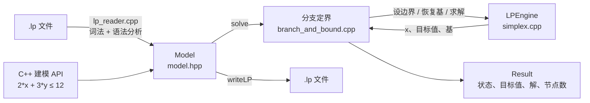

# minicplex

[](https://github.com/xudaniel/minicplex/actions/workflows/ci.yml)


一个用 **C++17 编写、零依赖的线性规划 / 混合整数规划（LP / MIP）求解器**。这是一个业余项目，目的是从内部
理解 IBM ILOG CPLEX 这类求解器的工作原理。它能读取 CPLEX `.lp` 文件，提供类似 Concert 的 C++ 建模 API，
并输出类似 CPLEX 的分支定界日志。

> 与 IBM 无关。这是一个学习项目，不是 CPLEX 的替代品：它使用稠密单纯形表，适合中小规模模型
>（几百行 / 几百列）。

想了解实现细节，请看下文的[代码解析](#代码解析)。产品需求文档见 [docs/PRD.md](docs/PRD.md)，版本更新记录见 [CHANGELOG.md](CHANGELOG.md)，发布说明见 [docs/releases](docs/releases/)。

## 功能一览

| 模块 | 已实现内容 |
|---|---|
| 线性规划 | 有界变量单纯形（变量边界不占约束行）：组合式第一阶段 + 原始单纯形，加对偶单纯形；Dantzig 定价，退化时切换 Bland 规则防止循环；定期从原矩阵重建单纯形表，抑制舍入误差 |
| 变量边界 | 上下界、自由变量、负边界、固定变量 |
| 约束 | `<=`、`>=`、`=`，右端项为负，冗余约束 |
| 整数规划 | 分支定界 + 下潜（plunging）：子节点从父节点的单纯形表热启动，用对偶单纯形几步重新求优；兄弟节点保存父节点的基，之后增量恢复；对偶单纯形中途达到截断值即剪枝；最优界优先选点、最分数变量分支、取整启发式、整数目标函数的界加强 |
| 求解参数 | 相对 MIP 间隙、节点上限、时间上限、只求 LP 松弛 |
| 输入输出 | CPLEX LP 格式读取（Minimize/Maximize、Subject To、Bounds、General、Binary、End）与写出 |
| 求解状态 | Optimal（最优）、Infeasible（不可行）、Unbounded（无界）、InfeasibleOrUnbounded、NodeLimit、TimeLimit、IterationLimit |

## 编译

```bash
cmake -S . -B build
cmake --build build -j
ctest --test-dir build          # 或 ./build/minicplex_tests
```

## 命令行用法

```bash
./build/minicplex examples/facility.lp
./build/minicplex --relax examples/knapsack.lp      # 只求 LP 松弛
./build/minicplex --gap 1e-4 --time 10 model.lp     # 设定间隙和时间上限
```

| 参数 | 说明 |
|---|---|
| `--relax` | 忽略整数约束，只求 LP 松弛 |
| `--gap G` | 相对 MIP 间隙（默认 1e-6） |
| `--nodes N` | 分支定界节点上限 |
| `--time T` | 时间上限（秒） |
| `--quiet` | 不打印节点日志 |
| `--all` | 也打印取值为 0 的变量 |
| `--write FILE` | 把读入的模型重新写成 LP 格式 |

输出示例：

```
minicplex 0.1 | examples/facility.lp
  15 variables (15 integer), 7 constraints, minimize

Status:       Optimal
Objective:    360
Best bound:   360   (gap 0.0000%)
Nodes:        13
```

## 例子

| 文件 | 类型 | 内容 |
|---|---|---|
| `examples/easy1_bakery.cpp` | 线性规划 | 面包店生产计划：最大利润 21 元（蛋糕 3 个、面包 1.5 个） |
| `examples/easy2_projects.cpp` | 0-1 整数规划 | 预算 10 万选投资项目：最大收益 16 万（选 A、C、D） |
| `examples/hard_production_plan.cpp` | 混合整数规划（复杂） | 3 产品 × 6 周生产排程：换线、最小批量、加班、仓储；最低成本 35,615 元（约 5,500 个节点，0.3 秒，与 HiGHS 结果一致） |
| `examples/hard_staff_schedule.cpp` | 0-1 整数规划（复杂） | 餐厅 8 人一周排班：覆盖需求、老员工坐镇、晚班后不接早班、连续上班 ≤ 3 天、新人带教、两人不同班；最低成本 6,571 元（19 个节点，0.02 秒，与 HiGHS 结果一致） |

```bash
./build/easy1_bakery
./build/easy2_projects
./build/hard_production_plan
./build/hard_staff_schedule
```

复杂例子运行后会导出 `.lp` 文件，可以用 HiGHS 独立验算（需要 Python + scipy）：

```bash
python3 tools/verify_with_highs.py build/hard_staff_schedule.lp
```

## C++ 建模 API

```cpp
#include "solver.hpp"
using namespace mcplex;

Model m;
Var chairs = m.addVar(0, INF, VarType::Integer, "chairs");   // 椅子（整数）
Var tables = m.addVar(0, INF, VarType::Integer, "tables");   // 桌子（整数）
m.addConstr(2 * chairs + 5 * tables <= 40, "wood");          // 木材
m.addConstr(3 * chairs + 2 * tables <= 30, "labor");         // 工时
m.addConstr(chairs >= tables, "mix");                        // 搭配
m.setObjective(30 * chairs + 70 * tables, ObjSense::Maximize);

Result r = solve(m);          // r.status、r.objective、r.x、r.nodes ……
m.writeLP(std::cout);         // 导出为 CPLEX LP 格式
```

## 工作原理

1. **计算形式**（`src/simplex.cpp`）：每条约束加一个松弛变量 `s = a·x`，得到 `A x − s = 0`，
   变量和松弛变量都带上下界。非基变量停在某个边界上（自由变量停在 0），所以变量边界不需要额外的约束行，
   全松弛变量基总是一个合法的初始基，也不需要人工变量。
2. **原始单纯形**：第一阶段最小化基变量越界量之和（每次迭代重新构造代价），第二阶段优化真正的目标；
   进基变量可以直接跳到另一个边界（bound flip），不必换基。
3. **对偶单纯形**：只要当前基对偶可行就用它。分支只是收紧某个基变量的边界，父节点的最优基对子节点
   仍然对偶可行，所以子节点通常几次主元运算就能重新求优。
4. **分支定界**（`src/branch_and_bound.cpp`）：沿取整方向一路下潜，每层都热启动；另一个子节点连同父节点的基
   放进队列。下潜结束后取界最好的节点，从当前单纯形表增量换到它保存的基，再用对偶单纯形求解。
   对偶目标值单调上升，一旦超过当前最优整数解就立即停止（截断剪枝）。

v1.0 内核与早期 v0.1 内核的对比（`bench/` 中 13 个模型，同一台机器）：

| | v0.1（两阶段稠密单纯形，每个节点从零求解） | v1.0（有界单纯形 + 对偶热启动） |
|---|---|---|
| 单纯形迭代总数 | 777,609 | 40,804（少 95%） |
| 总用时 | 2.78 秒 | 约 0.6 秒（快约 4.5 倍） |
| 员工排班例子 | 239 个节点，1.03 秒 | 19 个节点，0.02 秒 |

## 代码解析

这一节按“数据怎么流动”的顺序，逐个文件讲清楚 minicplex 是怎么工作的。核心代码（`include/` + `src/`）约 1,600 行，其中最重要的是 `src/simplex.cpp`（单纯形内核）和 `src/branch_and_bound.cpp`（分支定界）。

### 1. 整体结构



| 文件 | 行数 | 职责 |
|---|---|---|
| [`include/model.hpp`](include/model.hpp) | 150 | 建模层：`Var`、`LinExpr`、`Constraint`、`Model`，运算符重载 |
| [`src/model.cpp`](src/model.cpp) | 90 | 把模型写成 CPLEX LP 格式（`Model::writeLP`） |
| [`src/lp_reader.cpp`](src/lp_reader.cpp) | 307 | 读取 CPLEX LP 文件：词法分析 + 递归下降语法分析 |
| [`include/solver.hpp`](include/solver.hpp) | 136 | 对外接口 `solve` / `Params` / `Result`，以及内部的 `LPEngine` |
| [`src/simplex.cpp`](src/simplex.cpp) | 542 | 有界变量单纯形：原始单纯形、对偶单纯形、基的保存与恢复 |
| [`src/branch_and_bound.cpp`](src/branch_and_bound.cpp) | 289 | 分支定界：下潜、热启动、剪枝、启发式，以及 LP 直接求解 |
| [`src/main.cpp`](src/main.cpp) | 85 | 命令行程序 `minicplex` |

### 2. 建模层：`model.hpp`

**变量只是一个编号。** `Var` 里只有一个 `int id`，真正的信息（名字、上下界、类型）存在 `Model::vars` 里。这样变量可以随意复制，不会有悬空引用。

**线性表达式是“编号 → 系数”的映射加一个常数：**

```cpp
class LinExpr {
    std::map<int, double> terms;   // 变量编号 → 系数
    double constant = 0.0;
};
```

`LinExpr` 可以从 `double` 和 `Var` 隐式构造，所以 `2 * x + 3 * y - 5` 会自动变成表达式。`<=`、`>=`、`==` 被重载成返回 `Constraint` 而不是 `bool`：把“左边 − 右边”整理成 `Σ aⱼxⱼ (sense) rhs` 的标准形状，常数项移到右边。

**0-1 变量** 在 `addVar` 时把边界截到 [0, 1]。写 LP 文件时，如果 0-1 变量的边界被改过（例如员工请假被固定为 0），就改用 `General` 加显式边界写出，避免信息丢失（这是 v1.0 修复的 bug）。

### 3. LP 文件读取：`lp_reader.cpp`

分两步：

1. **`tokenize`（词法分析）** 把文本切成四种记号：数字、标识符、运算符（`<= >= = + - :`）、结束。反斜杠 `\` 之后到行尾是注释。数字是手工扫描的，而不是直接用 `strtod`，因为 `strtod` 会把 `0x1` 当成十六进制。每个记号还记录“是不是本行第一个记号”。
2. **`Parser`（语法分析）** 按段落解析：`Minimize/Maximize` → `Subject To` → `Bounds` → `General` → `Binary` → `End`。

几个关键设计：

- **段落关键字只在行首识别。** 这样变量即使叫 `max` 或 `bin`，只要不在行首，也不会被误当成关键字。
- **约束的右边只允许一个带符号的常数。** 如果允许表达式，`c1: x + y <= 4` 换行后紧跟的下一条约束开头（例如 `x - y >= 1`）会被误读成 `4 x`。
- **Bounds 支持全部常见写法：** `x free`、`x <= 5`、`x >= -2`、`x = 3`、`-1 <= x <= 4`、`-inf <= x <= 9`。写成 `v <= x` 时方向要反过来理解（是下界）。
- 出错时报告行号，例如 `LP parse error (line 3): dangling sign`。

### 4. 单纯形内核：`simplex.cpp`

这是整个项目的心脏。`LPEngine` 求解

> 最小化 c·x，约束 A x (≤, ≥, =) b，ℓ ≤ x ≤ u

（最大化问题在外面把目标乘以 −1。）

#### 4.1 计算形式：每行一个松弛变量

每条约束 i 配一个松弛变量 sᵢ，等于这一行的取值 aᵢ·x：

> A x − s = 0，　ℓ ≤ x ≤ u，　松弛变量的边界由约束方向决定

| 约束 | 松弛变量 sᵢ 的边界 |
|---|---|
| aᵢ·x ≤ b | (−∞, b] |
| aᵢ·x ≥ b | [b, +∞) |
| aᵢ·x = b | [b, b]（固定） |

这么做有两个好处：

- **全松弛变量基永远合法**（B = −I），不需要人工变量，也不需要“大 M”。
- **变量边界不占约束行。** 教科书的标准型会把每个 x ≤ u 变成一行，员工排班例子里 112 个 0-1 变量就会多出约 100 行；这里一行都不加。

#### 4.2 核心数据结构

| 成员 | 含义 |
|---|---|
| `T_` | 单纯形表 B⁻¹[A \| −I]，m 行 × (n+m) 列，按行连续存放 |
| `d_` | 既约成本 dⱼ = cⱼ − Σᵢ c_B(i)·T[i][j] |
| `x_` | 所有变量（结构变量 + 松弛变量）的当前取值 |
| `head_` | 每一行的基变量编号 |
| `stat_` | 每个变量的状态（见下表） |
| `A_`、`lb_`、`ub_`、`c_` | 原始数据，用于重建单纯形表 |

| 状态 | 含义 | 非基变量取值 |
|---|---|---|
| `kBasic` | 基变量 | 由方程算出 |
| `kLower` | 停在下界 | ℓⱼ |
| `kUpper` | 停在上界 | uⱼ |
| `kFree` | 自由变量（两边都无界） | 0 |
| `kFixed` | 上下界相等 | ℓⱼ |

内核始终维护这个不变式：

> 基变量取值 x_B = − Σ(非基 j) T[:, j] · xⱼ

初始时 T = [−A | I]，基变量就是全部松弛变量。

#### 4.3 `pivot(r, q)`：换基

标准的高斯-约当消元：第 r 行除以主元 T[r][q]，再从其他所有行（包括既约成本行 d）中消去第 q 列。有一个小优化：先把第 r 行的非零位置记进 `nz_`，后面每一行只更新这些位置。约束矩阵通常比较稀疏，这能省下大量乘法。

#### 4.4 `primal()`：原始单纯形

每次迭代分三步：

1. **定价（选进基变量）。** 如果有基变量越界，就处在**第一阶段**：临时构造一个代价，低于下界的基变量记 −1、高于上界的记 +1，目标是让越界总量变小（“组合式第一阶段”，每次迭代重新构造）。没有越界时处在**第二阶段**，直接用既约成本 d。

   | 非基变量状态 | 进基条件 | 移动方向 |
   |---|---|---|
   | 停在下界 | dⱼ < 0 | 增大 |
   | 停在上界 | dⱼ > 0 | 减小 |
   | 自由 | dⱼ ≠ 0 | 与 dⱼ 反向 |

   默认取 |dⱼ| 最大的（Dantzig 规则）；连续 50 次退化（步长为 0）后改用 Bland 最小编号规则，保证不会循环。

2. **比值检验（走多远）。** 进基变量每走一步，第 i 个基变量变化 −T[i][q]·方向。对每个基变量算出“走多远会碰到边界”，取最小值。第一阶段里，越界的基变量只在回到它被违反的边界时才挡路，这保证越界总量一直不增加。同样近的候选里，优先选 |主元| 更大的，数值更稳。

3. **更新。** 如果进基变量自己先碰到另一侧的边界，就只把它从下界“翻”到上界（bound flip），不换基；否则调用 `pivot`，离基变量停在它碰到的边界上。

第一阶段找不到改进方向 → **不可行**；第二阶段比值检验没有上限 → **无界**。

#### 4.5 `dual()`：对偶单纯形

当所有非基变量的既约成本符号都“正确”时（下界处 dⱼ ≥ 0、上界处 dⱼ ≤ 0），基是**对偶可行**的，可以用对偶单纯形：

1. **选离基行：** 越界最多的基变量。目标是把它推回被违反的那个边界。
2. **选进基列：** 在能把它往正确方向推的非基变量里，取 |dⱼ / T[r][j]| 最小的。这样换基后所有既约成本仍然符号正确，也就是保持对偶可行。
3. **更新取值并换基。** 没有符合条件的列 → 这一行永远回不到边界内 → **不可行**。

**为什么分支定界离不开它：** 分支只是收紧某个基变量的边界。既约成本 d 和边界无关，所以父节点的最优基对子节点仍然对偶可行，只是这个基变量越界了。对偶单纯形通常几步就能修好，不用从头求解。

**截断剪枝：** 对偶可行时，当前目标值 c·x 是这个子问题最优值的下界（弱对偶），而且每步只会变大。所以 `dual()` 每步检查一次：一旦超过 `cutoff`（当前最好整数解），立即返回 `Cutoff`，这个节点不用再算下去。

#### 4.6 `solve()`：总调度

```
修正非基变量的状态（边界变了，原来停的边界可能已经不存在）
重复最多 4 轮：
    若能通过把有界变量翻到另一侧边界变成对偶可行（makeDualFeasible）
        → 对偶单纯形
    否则
        → 原始单纯形（第一阶段 + 第二阶段）
    得到“最优”后，用重新计算的 x（以及每隔一段的 d）复核：
        仍然可行且最优 → 返回 Optimal（或 Cutoff）
        否则（舍入误差）→ 从原矩阵重建单纯形表，再来一轮
```

`makeDualFeasible()` 利用了一个简单事实：既约成本和边界无关。上下界都有限的非基变量，如果 dⱼ 符号不对，就把它翻到另一侧边界。只有一侧无界的变量翻不过去，这时才退回原始单纯形。

#### 4.7 `loadBasis()`：基的保存与恢复

`Basis` 只包含两样东西：每行的基变量 `head` 和每个变量的状态 `stat`。恢复时有两种方式：

- **增量恢复（默认）：** 在当前单纯形表上，只把目标基里缺的那几列换进来，替换掉不需要的行。
- **从头重建（`fromScratch`）：** 从 T = [−A | I] 出发重新换基，彻底清除累积的舍入误差。每做 max(200, 2m) 次主元运算会自动重建一次。

#### 4.8 数值容差

| 常量 | 取值 | 用途 |
|---|---|---|
| `kPrimalTol` | 1e-7 ×（1 + \|边界\|） | 判断变量是否越界 |
| `kDualTol` | 1e-9 | 判断既约成本符号 |
| `kPivotTol` | 1e-9 | 太小的主元元素不用 |
| `kBlandAfter` | 50 | 连续退化多少步后改用 Bland 规则 |

### 5. 分支定界：`branch_and_bound.cpp`

`solve()` 先把整数变量的边界取整（例如 [0.2, 0.8] 变成 [1, 0]，直接判不可行），然后：

- **没有整数变量：** 直接让 `LPEngine` 解一次，结束。
- **有整数变量：** 进入下面的主循环。

```
cur = 根节点；队列 open 为空
循环：
    若没有当前节点：
        open 为空 → 结束
        open 中最好的界已经和最优整数解足够接近 → 结束（已证明最优）
        取出界最小的节点，设置它的边界，恢复它保存的基
    在 cur 上求解 LP（带截断值）
        不可行 / 被截断 → 剪掉，回到队列
        LP 解全是整数 → 更新最优整数解，回到队列
        否则：
            试一下“四舍五入”启发式，可能得到新的整数解
            选分数部分最接近 0.5 的整数变量 xⱼ = v
            兄弟节点（另一侧）连同当前基一起放进队列
            cur 改成取整方向那一侧（分数部分 ≥ 0.5 往上，否则往下）
            只改 xⱼ 的边界，单纯形表原样保留 → 下一轮热启动（下潜）
```

几个细节：

- **节点** = 一组上下界 + 父节点的界 + 深度 + 父节点的最优基。队列按界从小到大排，界相同时深度大的优先。
- **截断值**：当前最优整数解减去允许的间隙。如果目标函数只含整数变量且系数都是整数，最优值一定是整数，截断值可以更激进地设为 “最优整数解 − 1 + 1e-6”，节点的界也可以向上取整（`strengthen`）。
- **根节点 LP 无界：** 按 CPLEX 的习惯报告 “InfeasibleOrUnbounded”，因为此时整数规划要么无界、要么不可行。
- **启发式解也要验证：** `tryIncumbent` 先把整数变量四舍五入，再用 `checkFeasible` 逐条检查约束和边界，通过了才接受。

**一个实验结论：** 取出队列里的节点时，也可以不恢复父节点的基，直接从当前的基开始用对偶单纯形（它对任何节点都对偶可行）。实测这样单纯形迭代多了约 3.5 倍、总用时更长，因为父节点的基离子节点的最优解近得多。所以保留了“保存并恢复父节点基”的做法。

### 6. 设计取舍与局限

| 选择 | 好处 | 代价 |
|---|---|---|
| 稠密单纯形表 | 代码短、容易读、容易调试 | 每次换基 O(m·(n+m))，内存 O(m·(n+m))，适合几百行 / 列 |
| 每行一个松弛变量 | 不需要人工变量，初始基永远合法 | 表多了 m 列 |
| 显式维护整张表 | 比值检验、恢复基都很直接 | 舍入误差会累积，需要定期重建 |
| 最分数变量分支 | 实现简单 | 比伪成本分支多搜不少节点 |
| 不做预处理和割平面 | 代码集中在核心算法上 | 难题的 LP 松弛偏弱 |

后续路线（见 PRD）：v1.1 加对偶值输出、割平面、预处理；v2.0 改为稀疏 LU 分解的修正单纯形，届时恢复基和换基都会便宜很多。

## 开发与测试

| 工具 | 作用 |
|---|---|
| `ctest --test-dir build` | 单元测试 + 所有例子 / 命令行冒烟测试 + 基准模型可解性 |
| `-DMINICPLEX_SANITIZE=ON` | 用 AddressSanitizer + UBSan 编译，检查内存越界和未定义行为 |
| `minicplex_gen` | 随机生成模型（`mixed` 混合整数、`mkp` 多维背包、`lp` 线性规划） |
| `minicplex_bench` | 批量求解目录下的 `.lp`，输出结果表 / CSV，并检查解是否可行 |
| `tools/fuzz_vs_highs.py` | 与 HiGHS 逐题对拍（需要 scipy） |
| `tools/bench_compare.py` | 与基线 CSV 对比：结果变了就失败，速度变化只打印 |

对拍示例：

```bash
./build/minicplex_gen --kind mixed --count 400 --seed 1 --out fuzz
./build/minicplex_bench fuzz --gap 1e-9 --quiet --csv fuzz/ours.csv
python3 tools/fuzz_vs_highs.py fuzz fuzz/ours.csv
```

GitHub Actions（`.github/workflows/ci.yml`）在每次提交时自动执行：Linux / macOS 编译与测试、Sanitizer 测试、
500 道随机题与 HiGHS 对拍（每次换随机种子）、基准测试与基线对比。

## 目录结构

```
docs/      PRD.md（产品需求文档）
include/   model.hpp  solver.hpp  lp_reader.hpp
src/       simplex.cpp  branch_and_bound.cpp  lp_reader.cpp  model.cpp  main.cpp
examples/  *.lp  api_demo.cpp  easy1/easy2/hard_* 例子
tools/     gen_random.cpp  bench.cpp  verify_with_highs.py  fuzz_vs_highs.py  bench_compare.py
bench/     models/（基准模型）  baseline.csv  baseline_v0.1.csv
tests/     test_solver.cpp
```

## 后续方向

稀疏 LU 分解的修正单纯形法（扩大到上千规模）、割平面（Gomory 割、覆盖割）、预处理（presolve）、
伪成本分支、MPS 文件支持。详见 PRD 的路线图。

## 许可证

MIT
