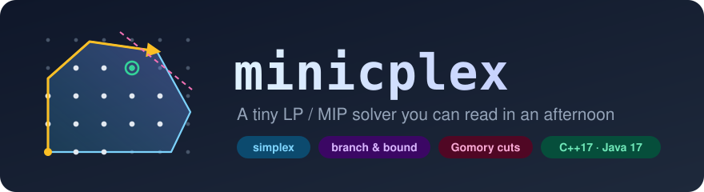
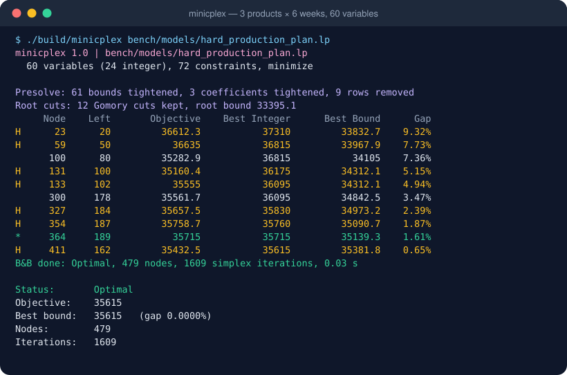
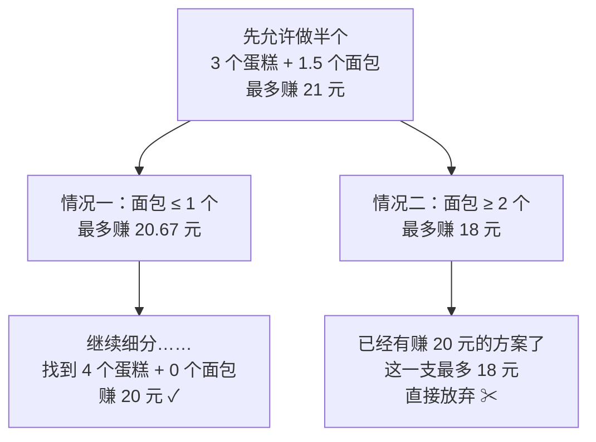
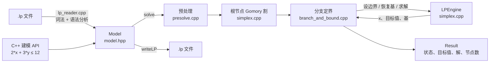
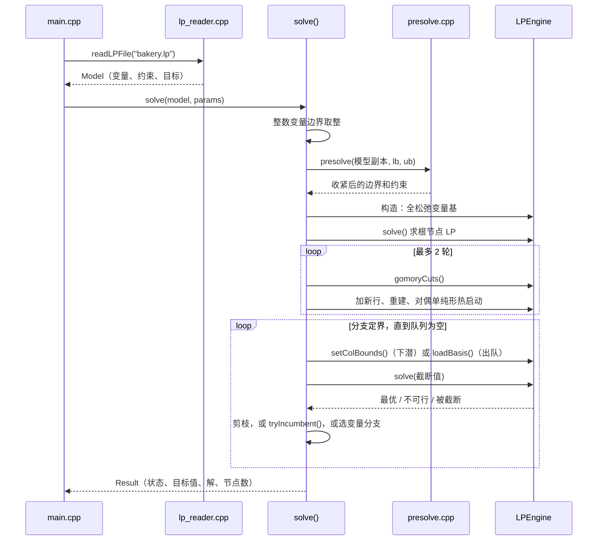

<div align="center">



<h3>从零写一个迷你版 CPLEX：线性规划 + 混合整数规划求解器</h3>

<p>
<a href="https://github.com/xudaniel/minicplex/actions/workflows/ci.yml"></a>
<a href="https://github.com/xudaniel/minicplex/releases"></a>


<a href="java/tutorial/README.md"></a>
<a href="python/tutorial/README.md"></a>
<a href="https://xudaniel.github.io/minicplex/python/"></a>

<a href="LICENSE"></a>
</p>

<p>
<a href="README.en.md">English</a> · <b>简体中文</b>
</p>

<p>
<a href="#30-秒上手"><b>30 秒上手</b></a> ·
<a href="#用大白话讲-minicplex先看这里">大白话原理</a> ·
<a href="#例子">例子</a> ·
<a href="#代码解析">代码解析</a> ·
<a href="#java-版">Java 版</a> ·
<a href="#python-版">Python 版</a> ·
<a href="#用它学-java"><b>用它学 Java</b></a> ·
<a href="#用它学-python"><b>用它学 Python</b></a> ·
<a href="docs/PRD.md">PRD</a> ·
<a href="ABOUT.md"><b>关于本项目</b></a>
</p>

</div>

**minicplex** 是一个零依赖的 LP / MIP 求解器，C++17 写成，另有逐行移植的 Java 版和纯 Python 版。它能读写 CPLEX `.lp` 文件，
提供类似 Concert 的建模 API，打印类似 CPLEX 的分支定界日志。写它是为了**从内部看懂** IBM ILOG CPLEX 这类求解器：
代码不长，注释详细，加上 `--trace` 就能看到单纯形的每一次换基、每一个割平面、每一次分支。
它同时是 **Java 课**和 **Python 课**的教材：从没写过代码的人，也能从打印第一行字一路学到读懂这个求解器。

<p align="center"></p>

<details>
<summary><b>📑 完整目录</b>（这份 README 很长，点开按需跳转；想了解项目来历和理念，请看 <a href="ABOUT.md">关于本项目</a>）</summary>

| 想做什么 | 去哪一节 |
|---|---|
| 马上跑起来 | [30 秒上手](#30-秒上手) · [编译](#编译) · [命令行用法](#命令行用法) |
| 学编程 | [用它学 Java](#用它学-java) · [用它学 Python](#用它学-python)（[网页版](https://xudaniel.github.io/minicplex/python/)） |
| 不懂数学，先看懂原理 | [用大白话讲 minicplex](#用大白话讲-minicplex先看这里) · [术语对照表](#术语对照表) · [它是怎么工作的](#它是怎么工作的) |
| 学建模 | [入门例子 01～05](#入门例子从最简单开始) · [进阶建模技巧 06～10](#进阶建模技巧0610) · [建模技巧速查表](#建模技巧速查表) · [练习题](#练习题) · [简单和复杂例子](#简单和复杂例子) |
| 在代码里调用 | [C++ 建模 API](#c-建模-api) · [Java 版](#java-版) · [Python 版](#python-版) · [功能一览](#功能一览) |
| 读懂源码 | [工作原理](#工作原理) · [代码解析](#代码解析)（单纯形内核、预处理、Gomory 割、分支定界、不变式、复杂度） |
| 参与开发 | [想改代码？从这里下手](#8-想改代码从这里下手) · [设计取舍与局限](#9-设计取舍与局限) · [开发与测试](#开发与测试) · [目录结构](#目录结构) · [CONTRIBUTING](CONTRIBUTING.md) |
| 了解项目 | [关于本项目](ABOUT.md)（缘起、理念、历程、FAQ） · [PRD](docs/PRD.md) · [更新日志](CHANGELOG.md) · [后续方向](#后续方向) |

</details>

## 亮点

<table>
<tr>
<td width="50%" valign="top">

**🧮 完整的求解流程**<br>
有界变量单纯形、对偶单纯形热启动、预处理、Gomory 割平面、可靠性分支、解抛光：现代 MIP 求解器的主干都在。

</td>
<td width="50%" valign="top">

**🔍 每一步都看得见**<br>
`--trace` 用中文打印求解过程：谁进基、谁离基、为什么剪枝、为什么选这个变量分支。适合当教材。

</td>
</tr>
<tr>
<td width="50%" valign="top">

**✅ 和权威求解器逐题对拍**<br>
与 HiGHS、OR-Tools 对比了上万道随机题，结果全部一致，还顺带抓到了 HiGHS 自己的错误。

</td>
<td width="50%" valign="top">

**☕🐍 C++、Java、Python 三个版本**<br>
Java 版和 Python 版都是逐行移植：同一道题三边的节点数、迭代次数、每一步 trace 完全相同，CI 每次提交都会核对。

</td>
</tr>
<tr>
<td width="50%" valign="top">

**📚 从零开始的优化教程**<br>
10 个由浅入深的建模例子（买苹果、选项目、排班……）、建模技巧速查表、带答案的练习题，以及逐函数的代码解析。

</td>
<td width="50%" valign="top">

**🪶 零依赖，小而可读**<br>
不依赖任何第三方库，C++ 核心代码约 2,200 行。一个下午就能从 `main` 读到分支定界。

</td>
</tr>
<tr>
<td width="50%" valign="top">

**🎓 用它学 Java 或 Python，从零开始**<br>
Java 课 20 节、Python 课 27 节（Python 课另有英文版）：8 节零基础小课（打印、变量、循环……），再用求解器的真实代码学类、集合、异常和测试；Python 课还讲运算符重载、dataclass、装饰器、生成器、调试，以及求解器凭什么说“这是最优解”。每节一道自动判分的练习。

</td>
<td width="50%" valign="top">

**🖥️ 用起来像 CPLEX**<br>
读写 CPLEX `.lp` 文件，命令行打印 CPLEX 风格的节点日志；线性规划还能输出影子价格（`--duals`）。

</td>
</tr>
</table>

## 30 秒上手

```bash
git clone https://github.com/xudaniel/minicplex.git && cd minicplex
cmake -S . -B build && cmake --build build -j
./build/minicplex examples/bakery.lp            # 解一道面包店整数规划
./build/minicplex examples/bakery.lp --trace    # 看它一步一步怎么算
java/build.sh && java/tutorial/run.sh A01       # 想学 Java？做第一道练习（只需要 JDK 17+）
python3 python/tutorial/run.py A01              # 想学 Python？做第一道练习（只需要 Python 3.9+，什么都不用装）
# 连 Python 都不想装？直接打开网页版：https://xudaniel.github.io/minicplex/python/
```

`examples/bakery.lp` 就是用 CPLEX LP 格式写的一道小题：

```text
Maximize
 profit: 5 cake + 4 bread
Subject To
 flour: 6 cake + 4 bread <= 24
 labor: cake + 2 bread <= 6
General
 cake bread
End
```

也可以直接在代码里建模：

<table>
<tr><th>C++</th><th>Java</th><th>Python</th></tr>
<tr>
<td>

```cpp
Model m;
Var cake  = m.addVar(0, INF, VarType::Integer, "cake");
Var bread = m.addVar(0, INF, VarType::Integer, "bread");
m.addConstr(6 * cake + 4 * bread <= 24, "flour");
m.addConstr(cake + 2 * bread <= 6, "labor");
m.setObjective(5 * cake + 4 * bread,
               ObjSense::Maximize);
Result r = solve(m);   // r.objective == 20
```

</td>
<td>

```java
Model m = new Model();
Var cake  = m.addVar(0, Model.INF, VarType.INTEGER, "cake");
Var bread = m.addVar(0, Model.INF, VarType.INTEGER, "bread");
m.addConstr(LinExpr.of(6, cake).plus(4, bread).le(24), "flour");
m.addConstr(LinExpr.of(cake).plus(2, bread).le(6), "labor");
m.setObjective(LinExpr.of(5, cake).plus(4, bread),
               ObjSense.MAXIMIZE);
Result r = Solver.solve(m);   // r.objective == 20
```

</td>
<td>

```python
m = Model()
cake  = m.add_var(0, INF, VarType.INTEGER, "cake")
bread = m.add_var(0, INF, VarType.INTEGER, "bread")
m.add_constr(6 * cake + 4 * bread <= 24, "flour")
m.add_constr(cake + 2 * bread <= 6, "labor")
m.set_objective(5 * cake + 4 * bread,
                ObjSense.MAXIMIZE)
r = solve(m)   # r.objective == 20
```

</td>
</tr>
</table>

## 用它学 Java

[`java/tutorial/`](java/tutorial/README.md) 是一门中文 Java 课，分两段。每节都有一道练习，运行后自动判分（✅ 对、❌ 不对、⏳ 还没写），卡住了可以看参考答案。

| 阶段 | 内容 | 适合谁 | 每节 |
|---|---|---|---|
| **入门 A1～A8** | 打印、变量和计算、判断、循环、方法、数组、字符串；最后做一个“挑水果”小项目，再和求解器对答案 | 从没写过代码的人 | 10～20 分钟 |
| **第 1～12 课** | 编译和包、小数误差、类、不可变对象、record 和 enum、集合、lambda 和优先队列、异常、字符串处理、测试；最后做一个“选课助手” | 学过一点编程的人 | 30～60 分钟 |

正式课的例子全部取自这个求解器的源代码，比如“为什么 `LinExpr` 每次都返回新对象”“分支定界的节点队列怎么排序”。学完不只会写 Java 语法，还能读懂一个完整的真实项目。

```bash
java/build.sh                  # 编译一次（约 10 秒，不需要 Maven，也不联网）
java/tutorial/run.sh A01       # 入门第一课的练习
java/tutorial/run.sh 01        # 正式课第一课的练习
java/tutorial/run.sh all       # 看看一共完成了多少
```

## 用它学 Python

[`python/tutorial/`](python/tutorial/README.md) 是一门中文 Python 课：8 节零基础 + 12 节读真实代码 + 7 节进阶，一共 27 节，每节一道自动判分的练习。
**🌐 [打开网页就能学](https://xudaniel.github.io/minicplex/python/)**：课文、编辑器、自动判分在同一个页面里，Python 在浏览器里运行，不用安装、不用注册，手机也能用。
这门课也有完整的**英文版**（[`python/tutorial/en/`](python/tutorial/en/README.md)，[网页版](https://xudaniel.github.io/minicplex/python/en/)），网页右上角可以一键切换中英文。
想在自己电脑上写也行：只需要 Python 3.9+，**不用装任何包**；运行练习的 `run.py` 本身也是 Python 写的，Windows、macOS、Linux 用法相同。

| 阶段 | 内容 | 适合谁 | 每节 |
|---|---|---|---|
| **入门 A1～A8** | `print` 和 f-string、变量和计算、判断、循环、函数、列表、字符串；最后做一个“挑水果”小项目，再和求解器对答案 | 从没写过代码的人 | 10～20 分钟 |
| **第 1～12 课** | 模块和 import、小数误差、列表推导式、类、**运算符重载**、dataclass 和 enum、字典和集合、排序和堆、异常、文本处理、测试；最后做一个“选课助手” | 学过一点编程的人 | 30～60 分钟 |
| **进阶 13～19 课** | 读懂报错和调试（🐞 找 bug 练习）、`*args` 和闭包、装饰器、生成器、文件和 CSV/JSON、命令行和打包；最后一课讲为什么知道是最优解（对偶证书和间隙） | 学完正式课的人 | 30～60 分钟 |

正式课的例子全部取自 Python 版求解器的源代码，比如“`2 * x + 3 * y <= 12` 为什么能变成一条约束”（`__mul__`、`__radd__`、`__le__`）、
“为什么 `Result` 的列表字段要写 `field(default_factory=list)`”、“分支定界的节点队列为什么是一个装元组的堆”。

```bash
python3 python/tutorial/run.py A01        # 入门第一课的练习
python3 python/tutorial/run.py 01         # 正式课第一课的练习
python3 python/tutorial/run.py all        # 看看一共完成了多少
```

## 它是怎么工作的


每一个方框在[代码解析](#代码解析)里都有对应的源码讲解。

> 与 IBM 无关。这是一个学习项目，不是 CPLEX 的替代品：它使用稠密单纯形表，适合中小规模模型
>（几百行 / 几百列）。产品需求文档见 [docs/PRD.md](docs/PRD.md)（[English](docs/PRD.en.md)），更新记录见 [CHANGELOG.md](CHANGELOG.md)，
> 发布说明见 [docs/releases](docs/releases/)。

## 用大白话讲 minicplex（先看这里）

> 不懂数学和编程也能看懂这一节。想看代码细节，再往下翻到“代码解析”。

### 它解决什么问题？

举个例子：一家面包店每天做蛋糕和面包。

- 蛋糕每个赚 5 元，面包每个赚 4 元
- 每天只有 24 公斤面粉、6 小时人工
- 蛋糕用 6 公斤面粉、1 小时；面包用 4 公斤面粉、2 小时

**问：各做多少个，赚得最多？**

这类“资源有限，怎么分配最划算”的问题叫**优化问题**。它在生活中到处都是：排班、物流路线、生产计划、投资组合、航班调度……IBM 的 **CPLEX** 是业界最有名的求解工具之一，minicplex 是我们自己从零写的一个迷你版。

- 如果允许做半个（比如 1.5 个面包），叫**线性规划（LP）**。答案：3 个蛋糕 + 1.5 个面包，赚 21 元。
- 如果必须做整数个，叫**整数规划（MIP）**。答案：4 个蛋糕 + 0 个面包，赚 20 元。

整数版看起来只多了一条“必须是整数”，难度却大得多。minicplex 大部分代码都在解决这一条。

### 它是怎么算的？三个比喻

**1. 单纯形法：沿着棱角爬山**

把所有限制条件画在图上，会围出一块多边形区域，里面的每个点都是一个“合法方案”。数学上可以证明：**最好的方案一定在某个角上**。单纯形法就是从一个角出发，每次走到一个更好的相邻角，直到周围没有更好的角为止，这个角就是答案。

**2. 分支定界：分情况讨论 + 及时放弃**

先假装可以做半个，算出“3 个蛋糕、1.5 个面包、赚 21 元”。1.5 个面包不合法，于是分成两种情况：



关键在“及时放弃”：只要某种情况**最好也比已有方案差**，整支就不用再算了。这就是“剪枝”，它能省掉绝大部分计算。

**3. 让它更快的几个技巧**

| 技巧 | 大白话 |
|---|---|
| 热启动 | 子问题只比上一个多改了一个条件，就从上次的答案接着算，不从头开始。好比导航改了一个路口，只需微调路线 |
| 对偶单纯形 | 专门用来“小改一下条件后快速修正答案”的方法，热启动就靠它 |
| 可靠性分支 | 记住“先拆哪个变量最有效”的经验。没经验的变量，先两边都试算几步再决定 |
| 割平面 | 加几条“对整数方案一定成立”的额外规则，把明显不可能的区域切掉，让估算更准 |
| 预处理 | 正式计算前先化简题目，比如推出“这个量最多只能是 20”，把松散的条件收紧 |
| 解抛光 | 接受一个答案之前，再用全新的计算严格核对一遍，防止小误差骗过检查 |

### 怎么保证它算得对？

自己写的求解器，最怕“看起来能跑，其实算错了”。所以每次改代码都要过四关：

1. **对答案：** 随机生成几千道题，和开源求解器 HiGHS 的答案逐题核对，到目前为止全部一致。顺带还发现了 HiGHS 自己的一个错误。
2. **暴力检查：** 小题直接把所有整数组合都试一遍，和 minicplex 的答案比对。
3. **内存检查：** 用专门的工具（Sanitizer）检查有没有越界、未定义行为这类隐蔽 bug。
4. **自动化：** 以上检查每次提交都在 GitHub 上自动运行（Linux 和 macOS 都测）。

### 有多快？

| | 最早版本 v0.1 | 现在 |
|---|---|---|
| 13 个基准模型总用时 | 2.78 秒 | 约 0.3 秒 |
| 生产排程例子（3 种产品 × 6 周） | 0.72 秒，搜索 6,101 种情况 | 0.03 秒，只搜索 419 种情况 |

它适合几百个变量规模的问题。更大的问题需要换成更高级的矩阵算法（稀疏 LU 分解），这是下一个大版本的目标。

### 术语对照表

| 术语 | 大白话 | 英文 |
|---|---|---|
| 目标函数 | 想让它最大（或最小）的那个数，比如利润 | objective |
| 约束 | 必须遵守的限制，比如面粉不超过 24 公斤 | constraint |
| 可行解 | 满足所有限制的方案 | feasible solution |
| 最优解 | 所有可行方案里最好的那个 | optimal solution |
| 线性规划 | 允许取小数的优化问题 | LP, linear programming |
| 整数规划 | 有些量必须是整数的优化问题 | MIP, mixed-integer programming |
| 松弛 | 暂时不管“必须是整数”，先算一个估计值 | relaxation |
| 界 | 某种情况“最好也就这样了”的估计 | bound |
| 剪枝 | 某种情况的界比已有方案差，整支放弃 | pruning |
| 节点 | 分情况讨论时的“一种情况” | node |
| 间隙 | 当前找到的方案离理论最好还差多少 | gap |
| 不可行 | 限制互相矛盾，一个方案都没有 | infeasible |
| 无界 | 目标可以无限变好（通常说明题目漏了限制） | unbounded |

## 功能一览

| 模块 | 已实现内容 |
|---|---|
| 线性规划 | 有界变量单纯形（变量边界不占约束行）：组合式第一阶段 + 原始单纯形，加对偶单纯形；Dantzig 定价，退化时切换 Bland 规则防止循环；定期从原矩阵重建单纯形表，抑制舍入误差 |
| 变量边界 | 上下界、自由变量、负边界、固定变量 |
| 约束 | `<=`、`>=`、`=`，右端项为负，冗余约束 |
| 整数规划 | **预处理**（边界传播、0-1 变量大 M 系数收紧、删除冗余行）→ **根节点 Gomory 混合整数割** → **分支定界**：可靠性分支（伪成本 + 强分支初始化）；下潜时子节点从父节点单纯形表热启动，用对偶单纯形几步重新求优；兄弟节点保存父节点的基；对偶单纯形达到截断值即剪枝；取整启发式 + 解抛光（固定整数、重解连续部分）；整数目标函数的界加强 |
| 灵敏度分析 | 线性规划的影子价格（对偶值）和既约成本：`Result::duals`、`Result::reducedCosts`，命令行 `--duals` |
| 求解参数 | 相对 MIP 间隙、节点上限、时间上限、只求 LP 松弛；分支规则、割平面轮数、预处理开关 |
| 输入输出 | CPLEX LP 格式读取（Minimize/Maximize、Subject To、Bounds、General、Binary、End）与写出 |
| 语言 | C++17 版（主版本）、Java 17 版和 Python 3.9+ 版（都是逐行移植，计算路径完全相同，CI 每次提交逐题核对） |
| 求解状态 | Optimal（最优）、Infeasible（不可行）、Unbounded（无界）、InfeasibleOrUnbounded、NodeLimit、TimeLimit、IterationLimit |

## 编译

```bash
cmake -S . -B build
cmake --build build -j
ctest --test-dir build          # 或 ./build/minicplex_tests
```

## 命令行用法

```bash
./build/minicplex examples/facility.lp
./build/minicplex --relax examples/knapsack.lp      # 只求 LP 松弛
./build/minicplex --gap 1e-4 --time 10 model.lp     # 设定间隙和时间上限
```

| 参数 | 说明 |
|---|---|
| `--relax` | 忽略整数约束，只求 LP 松弛 |
| `--gap G` | 相对 MIP 间隙（默认 1e-6） |
| `--absgap G` | 绝对 MIP 间隙（默认 1e-6，对应 CPLEX 的 EpAGap） |
| `--nodes N` | 分支定界节点上限 |
| `--time T` | 时间上限（秒） |
| `--quiet` | 不打印节点日志 |
| `--all` | 也打印取值为 0 的变量 |
| `--duals` | 线性规划：打印每条约束的影子价格（对偶值）和每个变量的既约成本 |
| `--write FILE` | 把读入的模型重新写成 LP 格式 |
| `--branch pc\|frac` | 分支规则：`pc` 可靠性 / 伪成本分支（默认），`frac` 最分数变量 |
| `--cuts K` | 根节点 Gomory 割的轮数（默认 2，0 为关闭） |
| `--no-presolve` | 关闭预处理 |
| `--trace` | 打印每一次换基和每一个分支决定（学习用，见[代码解析](#代码解析)） |

输出示例：

```
minicplex 1.0 | examples/facility.lp
  15 variables (15 integer), 7 constraints, minimize

Status:       Optimal
Objective:    360
Best bound:   360   (gap 0.0000%)
Nodes:        13
```

## 例子

例子分四级：**入门**（01～05，每个只学一个新概念）→ **进阶建模技巧**（06～10）→ **简单** → **复杂**。第一次用，建议从 01 按顺序看。

### 入门例子（从最简单开始）

都在 [`examples/basics/`](examples/basics/)，每个 30～60 行，中文逐行注释。编译后这样运行：

```bash
./build/basics_01_one_variable
./build/basics_02_two_variables
./build/basics_03_must_be_whole
./build/basics_04_yes_or_no
./build/basics_05_minimize
```

| 例子 | 问题 | 答案 | 新学到什么 |
|---|---|---|---|
| 01 一个变量 | 10 元钱，苹果 2 元一个，最多买几个？ | 5 个 | 最基本的四步 |
| 02 两个变量 | 苹果 2 元、香蕉 1 元，10 元钱、袋子装 7 个，苹果 3 分、香蕉 2 分，怎么买分最高？ | 3 个苹果 + 4 根香蕉，17 分 | 多条限制同时起作用 |
| 03 必须是整数 | 面包店：允许做半个和必须整数，答案有什么不同？ | 整数最优是 4 个蛋糕，赚 20 元 | 整数规划；四舍五入不一定最优 |
| 04 选或不选 | 周末 8 小时、4 件事，爬山和读书不能都选，选哪几件最开心？ | 看电影 + 爬山，开心值 15 | 0-1 变量；“不能同时选”怎么写 |
| 05 求最小 | 牛奶 3 元、鸡蛋 1 元，蛋白质至少 30 克、钙至少 600 毫克，怎么最省钱？ | 2 杯牛奶 + 3 个鸡蛋，9 元 | 最小化；“至少”用 ≥ |

#### 01 一个变量：最基本的四步

所有模型都是这四步：**建模型 → 建变量 → 加限制 → 定目标**，然后求解。

```cpp
Model m;                                                         // 1. 建一个空模型
Var apples = m.addVar(0, INF, VarType::Continuous, "apples");    // 2. 变量：买几个苹果，最少 0 个
m.addConstr(2 * apples <= 10, "money");                          // 3. 限制：2 元 × 个数 ≤ 10 元
m.setObjective(apples, ObjSense::Maximize);                      // 4. 目标：越多越好
Result r = solve(m);                                             // 求解
std::cout << r.x[apples.id];                                     // 读答案：5
```

- `addVar(下限, 上限, 类型, 名字)`：`INF` 表示没有上限。
- `r.x[变量.id]` 是这个变量的答案，`r.objective` 是目标值，`r.status` 是状态（`Optimal` 表示找到了最优解）。
- 加上 `--trace` 运行，能看到求解器只走了 1 步就到最优：苹果数从 0 往上增，直到钱花完（5 个）。

#### 02 两个变量：多条限制一起起作用

```cpp
m.addConstr(2 * apple + 1 * banana <= 10, "money");          // 钱
m.addConstr(apple + banana <= 7, "bag");                     // 袋子
m.setObjective(3 * apple + 2 * banana, ObjSense::Maximize);  // 总分
```

结果：3 个苹果 + 4 根香蕉，17 分，**钱刚好花完、袋子刚好装满**。最优解往往卡在好几条限制的“边上”，这正是大白话版里说的“最好的方案在角上”。

#### 03 必须是整数：四舍五入不一定最优

```cpp
Var cake = m.addVar(0, INF, VarType::Integer, "cake");   // Integer = 必须是整数
...
Params relaxed;
relaxed.relaxIntegrality = true;   // 先暂时允许小数，比较一下
```

程序会打印三行：

```
允许做半个：蛋糕 3，面包 1.5，赚 21 元
直接去掉小数：蛋糕 3，面包 1，赚 19 元
整数最优解：  蛋糕 4，面包 0，赚 20 元
```

直接把小数去掉只能赚 19 元，真正的整数最优是 20 元，而且是一个完全不同的方案（不做面包）。这就是整数规划需要分支定界的原因，求解过程见[代码解析的 5.4 节](#54-实例只用分支定界解面包店关掉预处理和割平面)。

#### 04 选或不选：0-1 变量

```cpp
pick.push_back(m.addVar(0, 1, VarType::Binary, ...));   // Binary：只能是 0（不选）或 1（选）
m.addConstr(time <= 8, "hours");                        // 总时间 ≤ 8 小时
m.addConstr(pick[1] + pick[3] <= 1, "not_both");        // 爬山 + 读书 ≤ 1：最多选一个
```

常见规则的写法：

| 规则 | 写法 |
|---|---|
| A 和 B 不能都选 | A + B ≤ 1 |
| A 和 B 至少选一个 | A + B ≥ 1 |
| 选了 A 就必须选 B | A ≤ B |
| A、B、C 正好选两个 | A + B + C = 2 |

#### 05 求最小：花最少的钱

```cpp
m.addConstr(8 * milk + 6 * egg >= 30, "protein");      // “至少”用 >=
m.addConstr(300 * milk + 30 * egg >= 600, "calcium");
m.setObjective(3 * milk + 1 * egg, ObjSense::Minimize);  // 求最小用 Minimize
```

结果：2 杯牛奶 + 3 个鸡蛋，9 元。蛋白质 34 克、钙 690 毫克，都满足要求。

### 进阶建模技巧（06～10）

入门例子学会了“怎么用”，这一组学“怎么把现实问题写成模型”。很多现实规则不能直接写成线性限制，需要一点技巧来改写。

```bash
./build/basics_06_shadow_price
./build/basics_07_fixed_cost
./build/basics_08_min_max
./build/basics_09_absolute_value
./build/basics_10_infeasible
```

| 例子 | 问题 | 答案 | 技巧 |
|---|---|---|---|
| 06 影子价格 | 面包店多 1 公斤面粉、多 1 小时人工，各值多少钱？ | 面粉 0.75 元/公斤，人工 0.5 元/小时 | 对偶值（`r.duals`） |
| 07 固定费用 | 做蛋糕先付 12 元模具费，做面包先付 2 元开炉费，怎么做最赚？ | 只做 3 个面包，净赚 10 元 | 0-1 开关 + 大 M |
| 08 最小化最大值 | 6 件任务分给 3 个人，怎么让最忙的人最早下班？ | 每人正好 6 小时 | 新变量 T ≥ 每人工作量，最小化 T |
| 09 绝对值 | 5 户人家在 1、3、8、10、20 公里处，快递点建在哪总距离最短？ | 建在 8 公里处，总距离 26 | d ≥ x − 位置 且 d ≥ 位置 − x |
| 10 不可行怎么办 | 数学至少 6 小时、英语至少 5 小时，但只有 8 小时 | 无解；总共缺 3 小时，代价决定缺哪科 | 弹性约束（缺口变量 + 代价） |

#### 06 影子价格：多一份资源值多少钱？

线性规划求完后，`r.duals[i]` 就是第 i 条限制的**影子价格**：这条限制的右边多 1 个单位，最优目标能多多少。

```
最大利润 21.00 元
面粉的影子价格：0.75 元/公斤
人工的影子价格：0.50 元/小时

面粉 25 公斤：利润 21.75 元（多了 0.75）
人工 7 小时： 利润 21.50 元（多了 0.50）

面粉 44 公斤：利润 30.00 元（按影子价格估算是 36.00）
```

- **怎么用：** 如果有人卖面粉，每公斤低于 0.75 元就值得买；请临时工，每小时低于 0.5 元才划算。
- **为什么面粉是 0.75：** 多 1 公斤面粉，可以多做 1/4 个蛋糕、少做 1/8 个面包（这样人工不变）：5/4 − 4/8 = 0.75 元。
- **有效范围：** 影子价格只在一定范围内成立。面粉多到 44 公斤时，人工变成瓶颈，只能赚到 30 元，而不是 36 元。
- **只有线性规划才有：** 整数规划没有影子价格，`r.duals` 为空。命令行可以用 `--duals` 查看，整数题加 `--relax` 看它的线性松弛。

#### 07 固定费用：要生产，先付开工费

“只要做了就要付一笔钱，不做就不用付”，这种规则要靠一个 0-1 开关变量 `open` 加一条“开关”限制：

```cpp
m.addConstr(c <= 4 * openCake, "cake_switch");   // 不开工（open = 0）就一个都不能做
m.setObjective(5 * c + 4 * b - 12 * openCake - 2 * openBread, ObjSense::Maximize);
```

- open = 0 时，数量只能是 0；open = 1 时，数量最多是 M，相当于没有限制。
- **M 怎么取：** 取“这个量最多可能是多少”。这里面粉最多够做 4 个蛋糕，所以 M = 4。
- **M 取太大会怎样：** 答案还是对的，但“先允许小数”时的估算会变得很宽松：M = 4 时估算最多赚 11 元，M = 1000 时估算是 20.96 元，而真实答案是 10 元。估算越松，大题里分支定界要搜的节点越多。minicplex 的预处理会自动收紧一部分这样的大 M。

#### 08 最小化最大值：公平分配

目标“让最忙的人尽量不忙”里有一个“最大值”，不能直接写进目标。做法是新建一个变量 T：

```cpp
m.addConstr(load <= T, "load" + std::to_string(p));   // 每个人的工作量都 ≤ T
m.setObjective(T, ObjSense::Minimize);                // 把 T 压到最小
```

最优时 T 就等于真正的最大工作量。结果：{3, 3}、{5, 1}、{4, 2}，每人正好 6 小时。同样的写法也能求“最大化最小值”，例如让收入最低的人尽量多：每人收入 ≥ T，然后最大化 T。

#### 09 绝对值：选址让总距离最短

距离 |x − 位置| 不是线性的。为每户人家新建一个变量 d，加两条限制：

```cpp
m.addConstr(d[i] >= x - home[i], "right" + std::to_string(i));
m.addConstr(d[i] >= home[i] - x, "left" + std::to_string(i));
// 目标：最小化所有 d 的和
```

求最小时，d 会被压到两者中较大的那个，正好等于绝对值。结果建在 8 公里处，总距离 26 公里，正好是 5 个位置的**中位数**。很多人的第一反应是建在平均位置 8.4，总距离反而是 26.4 公里。

> **注意：** 这个技巧只在“绝对值越小越好”时成立。如果目标是让绝对值越大越好，就需要 0-1 变量了。

#### 10 题目无解怎么办？

求解器报 `Infeasible` 时，说明限制互相矛盾，但不会告诉你差多少、该放弃哪一条。做法是**弹性约束**：给每条“可以商量”的限制加一个缺口变量，允许不满足，但缺口要付代价：

```cpp
m.addConstr(math + shortMath >= 6, "math_min");         // 允许数学少学 shortMath 小时
m.addConstr(eng + shortEng >= 5, "english_min");
m.addConstr(math + eng <= 8, "time");                    // 时间是硬限制，不加缺口
m.setObjective(3 * shortMath + 1 * shortEng, ObjSense::Minimize);
```

结果：总共一定缺 3 小时。数学缺口的代价设得更高（3 对 1）时，求解器保住数学 6 小时，让英语缺 3 小时。这个技巧在排班、排课这类经常“无解”的问题里非常实用。

### 建模技巧速查表

| 想表达的规则 | 写法（x、y 是普通变量，a、b 是 0-1 变量） |
|---|---|
| A 和 B 不能都选 | a + b ≤ 1 |
| A 和 B 至少选一个 | a + b ≥ 1 |
| 选了 A 就必须选 B | a ≤ b |
| A 和 B 要么都选、要么都不选 | a = b |
| 正好选 k 个 | a₁ + a₂ + … = k |
| 不开工就不能生产（固定费用） | x ≤ M·a，目标里减去 开工费 × a |
| 开工就至少生产一个批量 | x ≥ 最小批量 × a |
| 让最大值最小 | 新变量 T，每一项 ≤ T，最小化 T |
| 让最小值最大 | 新变量 T，每一项 ≥ T，最大化 T |
| 让绝对值之和最小 | 新变量 d ≥ x − c 且 d ≥ c − x，最小化 Σd |
| 题目无解时找差多少 | 每条软限制加缺口变量 s ≥ 0，最小化 Σ 代价 × s |
| 多一份资源值多少 | 解线性规划，看影子价格 `r.duals` |

### 练习题

每道题都可以在对应例子的代码上改一两行来求解。答案都用 minicplex 算过，点开查看。

1. 例 02 的袋子只能装 6 个水果，怎么买总分最高？
2. 例 04 加一条规则：看电影和吃大餐要么一起去、要么都不去。现在选哪几件？
3. 例 05 的鸡蛋涨到 2 元一个，最省钱的搭配是什么？
4. 例 06 的蛋糕利润降到 4.5 元，面粉和人工的影子价格各是多少？
5. 例 09 再加一户人家，位置在 30 公里处。快递点建在哪？

<details>
<summary>点开看答案</summary>

1. 4 个苹果 + 2 根香蕉，16 分。（钱 10 元和袋子 6 个都刚好用满）
2. 加一条 `pick[0] == pick[2]`。答案：看电影 + 吃大餐，开心值 10。爬山（5 小时）没法再和这一对同时选，单独选爬山只有 9。
3. 3 杯牛奶 + 1 个鸡蛋，11 元。（蛋白质 30 克刚好够，钙 930 毫克）
4. 面粉 0.625 元/公斤，人工 0.75 元/小时，最大利润 19.5 元。蛋糕不那么赚钱了，人工反而更值钱。
5. 8 到 10 公里之间任何位置都行，总距离都是 48 公里。人家数是偶数时，中间两户之间的每个点都是最优解。最优解不一定只有一个，求解器给出的只是其中之一（minicplex 给的是 10）。

</details>

### 简单和复杂例子

| 文件 | 类型 | 内容 |
|---|---|---|
| `examples/bakery.lp` | 整数规划 | 面包店整数版（配合 `--trace` 看完整求解过程）：最大利润 20 元（4 个蛋糕） |
| `examples/easy1_bakery.cpp` | 线性规划 | 面包店生产计划：最大利润 21 元（蛋糕 3 个、面包 1.5 个） |
| `examples/easy2_projects.cpp` | 0-1 整数规划 | 预算 10 万选投资项目：最大收益 16 万（选 A、C、D） |
| `examples/hard_production_plan.cpp` | 混合整数规划（复杂） | 3 产品 × 6 周生产排程：换线、最小批量、加班、仓储；最低成本 35,615 元（约 420 个节点，0.02 秒，与 HiGHS 结果一致） |
| `examples/hard_staff_schedule.cpp` | 0-1 整数规划（复杂） | 餐厅 8 人一周排班：覆盖需求、老员工坐镇、晚班后不接早班、连续上班 ≤ 3 天、新人带教、两人不同班；最低成本 6,571 元（11 个节点，0.06 秒，与 HiGHS 结果一致） |

```bash
./build/easy1_bakery
./build/easy2_projects
./build/hard_production_plan
./build/hard_staff_schedule
```

复杂例子运行后会导出 `.lp` 文件，可以用 HiGHS 独立验算（需要 Python + scipy）：

```bash
python3 tools/verify_with_highs.py build/hard_staff_schedule.lp
```

## C++ 建模 API

```cpp
#include "solver.hpp"
using namespace mcplex;

Model m;
Var chairs = m.addVar(0, INF, VarType::Integer, "chairs");   // 椅子（整数）
Var tables = m.addVar(0, INF, VarType::Integer, "tables");   // 桌子（整数）
m.addConstr(2 * chairs + 5 * tables <= 40, "wood");          // 木材
m.addConstr(3 * chairs + 2 * tables <= 30, "labor");         // 工时
m.addConstr(chairs >= tables, "mix");                        // 搭配
m.setObjective(30 * chairs + 70 * tables, ObjSense::Maximize);

Result r = solve(m);          // r.status、r.objective、r.x、r.nodes ……
m.writeLP(std::cout);         // 导出为 CPLEX LP 格式
```

## Java 版

> **想用 minicplex 学 Java？** 见上面的[用它学 Java](#用它学-java)：20 节课，每节一道自动判分的练习。

`java/` 目录是整个求解器的 Java 移植：单纯形内核、预处理、Gomory 割、可靠性分支、LP 文件读写、命令行、
`--trace` 教学输出、基准和随机题工具、全部 15 个例子和测试，一个不少。Java 17 起可用，不依赖任何第三方库。

### 构建与运行

```bash
java/build.sh                       # 只用 javac + jar，不需要 Maven、不需要联网；会顺便跑测试
# 或者：mvn -f java/pom.xml package

java -jar java/build/minicplex.jar examples/bakery.lp --trace     # 命令行，参数和 C++ 版完全一样
java -cp java/build/minicplex.jar minicplex.examples.Basics01OneVariable
java -cp java/build/minicplex.jar minicplex.tools.Bench bench/models
```

### 建模 API

Java 没有运算符重载，所以 `2 * x + 3 * y <= 12` 写成链式调用 `LinExpr.of(2, x).plus(3, y).le(12)`。
`LinExpr` 是不可变对象，`plus` 返回一个新表达式，循环里累加要写 `e = e.plus(...)`。

```java
import minicplex.*;

Model m = new Model();
Var chairs = m.addVar(0, Model.INF, VarType.INTEGER, "chairs");    // 椅子（整数）
Var tables = m.addVar(0, Model.INF, VarType.INTEGER, "tables");    // 桌子（整数）
m.addConstr(LinExpr.of(2, chairs).plus(5, tables).le(40), "wood");  // 木材
m.addConstr(LinExpr.of(3, chairs).plus(2, tables).le(30), "labor"); // 工时
m.addConstr(LinExpr.of(chairs).ge(tables), "mix");                  // 搭配
m.setObjective(LinExpr.of(30, chairs).plus(70, tables), ObjSense.MAXIMIZE);

Result r = Solver.solve(m);    // r.status、r.objective、r.value(chairs)、r.nodes ……
System.out.print(m.toLP());    // 导出为 CPLEX LP 格式
```

| C++ | Java |
|---|---|
| `2 * x + 3 * y <= 12` | `LinExpr.of(2, x).plus(3, y).le(12)` |
| `x >= y`、`x == 5` | `LinExpr.of(x).ge(y)`、`LinExpr.of(x).eq(5)` |
| `e += 4 * v;` | `e = e.plus(4, v);` |
| `INF` | `Model.INF` |
| `VarType::Integer`、`ObjSense::Maximize` | `VarType.INTEGER`、`ObjSense.MAXIMIZE` |
| `solve(m, p)` | `Solver.solve(m, p)` |
| `r.x[v.id]` | `r.value(v)` 或 `r.x[v.id()]` |
| `toString(r.status)` | `r.status`（`toString()` 输出和 C++ 一样，如 `Optimal`） |
| `readLPFile(path)`、`m.writeLP(os)` | `LpReader.readFile(path)`、`m.toLP()` |
| `checkFeasible(m, x)`、`evalObjective(m, x)` | `Solver.checkFeasible(m, x)`、`Solver.evalObjective(m, x)` |

`Params` 的字段名、默认值和 C++ 完全相同（`relaxIntegrality`、`cutRounds`、`presolve`、`mipGap`、`trace` ……）。

### 例子对照

| C++ | Java（`java/examples/minicplex/examples/`） |
|---|---|
| `examples/basics/01_one_variable.cpp` … `10_infeasible.cpp` | `Basics01OneVariable.java` … `Basics10Infeasible.java` |
| `easy1_bakery.cpp`、`easy2_projects.cpp` | `Easy1Bakery.java`、`Easy2Projects.java` |
| `hard_production_plan.cpp`、`hard_staff_schedule.cpp` | `HardProductionPlan.java`、`HardStaffSchedule.java` |
| `api_demo.cpp` | `ApiDemo.java` |

中文注释和 C++ 版逐句对应，可以左右对照着读。

### 怎么保证两个版本一样？

“移植”最容易出的问题是：看起来一样，其实某个角落的舍入、某个平局的处理不一样，跑大题时悄悄走上另一条路。
所以这里不满足于“答案一样”，而是要求**计算路径一样**：

| 检查 | 结果 |
|---|---|
| 15 个例子的完整输出（除用时外）和导出的 `.lp` 文件 | 逐字相同 |
| `--trace` 输出（每一次换基、每一个割平面、每一个节点） | 逐行相同 |
| `bench/models` 13 个基准模型 | 状态、目标值、节点数、迭代次数全部相同 |
| 2,000 道随机混合整数题（5 个种子） | 全部相同，节点数和迭代次数也相同 |
| Java 版自己的测试（与 C++ 测试一一对应：暴力枚举 500 题 × 3 套参数、Gomory 割有效性、影子价格扰动核对……） | 40 项全部通过 |

几个让两边“逐位一致”的细节：

- **数字格式**：`Fmt.g` 精确模仿 C 的 `printf("%g")`，`--trace` 和日志里的数字才能逐字相同。
- **取整**：C++ 的 `std::round` 是“四舍五入、0.5 远离零”，Java 的 `Math.round` 不是，所以用 `Solver.cround` 模仿前者。
- **平局**：移植时发现，员工排班例子里两个效力完全相同的割平面，C++ 的 `std::sort`（不稳定排序）和 Java 的稳定排序挑出了不同的那个，
  后面就走了不同的路（最优值相同，节点数 8 和 11）。现在两边都用稳定排序，节点队列也加了插入顺序作最后的平局规则。
  这顺带修好了 C++ 版的一个隐患：以前换一个标准库（比如 macOS 的 libc++），搜索路径就可能不同。
- **FMA**：第一次在 CI 上对比时，C++ 和 Java 又对不上了，本机却完全一样。原因是 CI 的 GCC 15 默认面向带 FMA 指令的 CPU，
  会把 `a*b + c` 合成一条“乘加”指令，少一次舍入，最后一位不同，单纯形就选了另一个进基变量。现在 C++ 用
  `-ffp-contract=off` 编译（`CMakeLists.txt`），不管什么编译器、什么 CPU，算出来的每一位都和 Java 一样。
  这同样修好了 C++ 版自己的隐患：以前 CI 上员工排班是 4 个节点，本机是 11 个。
- **中文输出**：`Fmt.useUtf8Output()` 让控制台在任何系统语言下都按 UTF-8 输出。

CI 每次提交都会在 JDK 17 和 21 上重新跑一遍：Java 测试、例子逐字对比、基准模型对比、300 道新随机题对比（要求节点数和迭代次数也相同）。

### 速度

同样的算法、同样的步数，Java 版在 `bench/models` 上总用时约 0.72 秒，C++ 版约 0.39 秒（JIT 预热也算在内）。
对教学和中小模型来说，两个都够用。

## Python 版

> **想用 minicplex 学 Python？** 见上面的[用它学 Python](#用它学-python)：27 节课，每节一道自动判分的练习。

`python/` 目录是整个求解器的纯 Python 移植（约 2,700 行，含注释）：单纯形内核、预处理、Gomory 割、可靠性分支、LP 文件读写、命令行、
`--trace` 教学输出、批量求解工具、全部 15 个例子和测试。只用标准库，Python 3.9 起可用。

### 运行

```bash
python3 python/examples/easy1_bakery.py                    # 例子：不用安装，直接运行
cd python && python3 -m minicplex ../examples/bakery.lp     # 命令行，参数和 C++ 版完全一样（--trace、--duals ……）
python3 -m minicplex.bench ../bench/models                  # 批量求解，CSV 和 C++ 版同格式
python3 -m unittest discover -s python/tests -v             # 测试（在仓库根目录运行）
pip install ./python                                        # 可选：安装后任何地方都能 import minicplex
```

### 建模 API

Python 和 C++ 一样有运算符重载，所以建模代码几乎和 C++ 一模一样，只是名字换成了 Python 习惯的小写加下划线：

```python
from minicplex import Model, VarType, ObjSense, Params, INF, solve

m = Model()
chairs = m.add_var(0, INF, VarType.INTEGER, "chairs")     # 椅子（整数）
tables = m.add_var(0, INF, VarType.INTEGER, "tables")     # 桌子（整数）
m.add_constr(2 * chairs + 5 * tables <= 40, "wood")       # 木材
m.add_constr(3 * chairs + 2 * tables <= 30, "labor")      # 工时
m.add_constr(chairs >= tables, "mix")                     # 搭配
m.set_objective(30 * chairs + 70 * tables, ObjSense.MAXIMIZE)

r = solve(m, Params(verbose=True))   # r.status、r.objective、r.value(chairs)、r.nodes ……
print(m.to_lp())                     # 导出为 CPLEX LP 格式
```

| C++ | Python |
|---|---|
| `m.addVar(0, INF, VarType::Integer, "x")` | `m.add_var(0, INF, VarType.INTEGER, "x")`；参数都有默认值：`m.add_var(name="x")` |
| `e += 4 * v;`、`LinExpr total;` | `e += 4 * v`、`total = LinExpr()`；也可以 `sum((c * v for ...), LinExpr())` |
| `Params p; p.trace = true;` | `Params(trace=True)`（dataclass，字段和 C++ 一一对应：`relax_integrality`、`cut_rounds` ……） |
| `solve(m, p)`、`r.x[v.id]` | `solve(m, p)`、`r.value(v)` 或 `r.x[v.id]` |
| `toString(r.status)` | `str(r.status)`（输出和 C++ 一样，如 `Optimal`） |
| `readLPFile(path)`、`m.writeLP(os)` | `read_file(path)`、`m.to_lp()` / `m.write_lp(path)` |
| `checkFeasible(m, x)`、`evalObjective(m, x)` | `check_feasible(m, x)`、`eval_objective(m, x)` |

注意：和 C++ 一样，`x == 3` 得到的是一条约束而不是 `True`/`False`。想判断两个把手是不是同一个变量，比较 `x.id == y.id`
（两边都是变量时 `x == y` 在 `if` 里也会按“是不是同一个变量”来算，所以 `x in [x, y]`、`{x: 1}[x]` 照样能用）。

### 例子对照

Python 例子在 `python/examples/`，文件名和 C++ 生成的程序名一样：`basics_01_one_variable.py` … `basics_10_infeasible.py`、
`easy1_bakery.py`、`easy2_projects.py`、`hard_production_plan.py`、`hard_staff_schedule.py`、`api_demo.py`。中文注释和 C++ 版逐句对应。

### 三个版本一样吗？

一样，而且是“计算路径”一样，不只是答案一样：

| 检查 | 结果 |
|---|---|
| 15 个例子的完整输出（除用时外）和导出的 `.lp` 文件 | 和 C++ 逐字相同 |
| `--trace` 输出 | 逐行相同 |
| `bench/models` 13 个基准模型 | 状态、目标值、节点数、迭代次数全部相同 |
| 随机题：混合整数 600 道、纯 LP 40 道、多维背包 10 道 | 全部相同，节点数和迭代次数也相同 |
| Python 版自己的测试（暴力枚举 500 题 × 3 套参数、Gomory 割有效性、影子价格有限差分、运算符重载……） | 20 个测试全部通过 |

要做到逐位一致，Python 版额外处理了几件事（都在 [`jmath.py`](python/minicplex/jmath.py) 里）：Python 的 `round` 是“一半取偶数”，
所以自己实现 C++ 的 `std::round`；`math.ceil` / `math.floor` 返回整数，会丢掉 `-0.0` 的符号，也会在遇到无穷大时报错；
`min` 遇到 `0.0` 和 `-0.0` 时的选择和 Java 的 `Math.min` 不同。数字格式直接用 `"%.*g"`，它和 C 的 `printf` 本来就一致。
CI 每次提交都在 Python 3.9 和 3.13 上重新跑一遍：测试、例子逐字对比、基准模型对比、300 道新随机题对比。

### 速度

纯解释执行，`bench/models` 上总用时约 20 秒（C++ 约 0.4 秒）。教学、例子和几十个变量的模型都是秒级；更大的模型请用 C++ 或 Java 版。

## 工作原理

1. **计算形式**（`src/simplex.cpp`）：每条约束加一个松弛变量 `s = a·x`，得到 `A x − s = 0`，
   变量和松弛变量都带上下界。非基变量停在某个边界上（自由变量停在 0），所以变量边界不需要额外的约束行，
   全松弛变量基总是一个合法的初始基，也不需要人工变量。
2. **原始单纯形**：第一阶段最小化基变量越界量之和（每次迭代重新构造代价），第二阶段优化真正的目标；
   进基变量可以直接跳到另一个边界（bound flip），不必换基。
3. **对偶单纯形**：只要当前基对偶可行就用它。分支只是收紧某个基变量的边界，父节点的最优基对子节点
   仍然对偶可行，所以子节点通常几次主元运算就能重新求优。
4. **分支定界**（`src/branch_and_bound.cpp`）：沿取整方向一路下潜，每层都热启动；另一个子节点连同父节点的基
   放进队列。下潜结束后取界最好的节点，从当前单纯形表增量换到它保存的基，再用对偶单纯形求解。
   对偶目标值单调上升，一旦超过当前最优整数解就立即停止（截断剪枝）。

v1.0 内核与早期 v0.1 内核的对比（`bench/` 中 13 个模型，同一台机器）：

| | v0.1（两阶段稠密单纯形，每个节点从零求解） | v1.0（有界单纯形 + 对偶热启动） |
|---|---|---|
| 单纯形迭代总数 | 777,609 | 40,804（少 95%） |
| 总用时 | 2.78 秒 | 约 0.6 秒（快约 4.5 倍） |
| 员工排班例子 | 239 个节点，1.03 秒 | 19 个节点，0.02 秒 |

## 代码解析

> 这一节是给程序员看的。只想了解原理，看前面的[大白话版](#用大白话讲-minicplex先看这里)就够了。每个小节开头的“**一句话**”是这一节的大白话总结。

这一节按“数据怎么流动”的顺序，逐个文件讲清楚 minicplex 是怎么工作的。核心代码（`include/` + `src/`）约 2,200 行，其中最重要的是 `src/simplex.cpp`（单纯形内核）和 `src/branch_and_bound.cpp`（分支定界）。

### 0. 怎么读这份代码

**推荐顺序**（从外到内，每一步都能单独看懂）：

| 步骤 | 文件 | 重点看什么 | 约多少行 |
|---|---|---|---|
| 1 | `examples/basics/01～05` | 用户怎么建模、怎么调用 `solve()`（先跑一遍 `./build/basics_01_one_variable --trace`，只有 1 步） | 每个 30～50 |
| 2 | `include/model.hpp` | `Var`、`LinExpr`、`Constraint` 三个数据结构 | 150 |
| 3 | `include/solver.hpp` | `Params`、`Result`，以及 `LPEngine` 的成员变量 | 172 |
| 4 | `src/simplex.cpp` | 依次看 `pivot` → `primal` → `dual` → `solve` → `loadBasis` | 710 |
| 5 | `src/branch_and_bound.cpp` | `solve()` 从上到下：预处理 → 割平面 → 主循环 | 533 |
| 6 | `src/presolve.cpp`、`src/lp_reader.cpp` | 相对独立，最后看 | 472 |

**边读边跑：** 命令行加 `--trace`，求解器会把每一次换基、每一个分支决定都打印出来。读代码时对照着看，最容易理解：

```bash
./build/minicplex --trace examples/bakery.lp                                      # 默认设置
./build/minicplex --trace --no-presolve --cuts 0 --branch frac examples/bakery.lp  # 只看最基本的分支定界
./build/minicplex --trace --relax examples/bakery.lp                              # 只看单纯形法
```

下文所有“实例”都是这几条命令的真实输出，例子用的是前面大白话版里的面包店（[`examples/bakery.lp`](examples/bakery.lp)）。

### 1. 整体结构



| 文件 | 行数 | 职责 |
|---|---|---|
| [`include/model.hpp`](include/model.hpp) | 150 | 建模层：`Var`、`LinExpr`、`Constraint`、`Model`，运算符重载 |
| [`src/model.cpp`](src/model.cpp) | 90 | 把模型写成 CPLEX LP 格式（`Model::writeLP`） |
| [`src/lp_reader.cpp`](src/lp_reader.cpp) | 307 | 读取 CPLEX LP 文件：词法分析 + 递归下降语法分析 |
| [`include/solver.hpp`](include/solver.hpp) | 172 | 对外接口 `solve` / `Params` / `Result`，以及内部的 `LPEngine` |
| [`src/simplex.cpp`](src/simplex.cpp) | 710 | 有界变量单纯形：原始单纯形、对偶单纯形、基的保存与恢复；Gomory 割的生成 |
| [`src/presolve.cpp`](src/presolve.cpp) | 165 | 预处理：边界传播、大 M 系数收紧、删除冗余行 |
| [`src/branch_and_bound.cpp`](src/branch_and_bound.cpp) | 533 | 求解总流程：预处理 → 根节点割 → 分支定界（可靠性分支、下潜、热启动、剪枝、解抛光），以及 LP 直接求解 |
| [`src/main.cpp`](src/main.cpp) | 93 | 命令行程序 `minicplex` |

**一次求解的调用链：**



### 2. 建模层：`model.hpp`

**一句话：** 把“2 × 椅子 + 3 × 桌子 ≤ 12”这种写法，变成程序能处理的数据。


**变量只是一个编号。** `Var` 里只有一个 `int id`，真正的信息（名字、上下界、类型）存在 `Model::vars` 里。这样变量可以随意复制，不会有悬空引用。

**线性表达式是“编号 → 系数”的映射加一个常数：**

```cpp
class LinExpr {
    std::map<int, double> terms;   // 变量编号 → 系数
    double constant = 0.0;
};
```

`LinExpr` 可以从 `double` 和 `Var` 隐式构造，所以 `2 * x + 3 * y - 5` 会自动变成表达式。`<=`、`>=`、`==` 被重载成返回 `Constraint` 而不是 `bool`：把“左边 − 右边”整理成 `Σ aⱼxⱼ (sense) rhs` 的标准形状，常数项移到右边。

**0-1 变量** 在 `addVar` 时把边界截到 [0, 1]。写 LP 文件时，如果 0-1 变量的边界被改过（例如员工请假被固定为 0），就改用 `General` 加显式边界写出，避免信息丢失（这是 v1.0 修复的 bug）。

**举例：** `m.addConstr(2 * chairs + 5 * tables <= 40)` 的执行过程是：
1. `2 * chairs` 先把 `Var` 隐式变成 `LinExpr{chairs: 1}`，再乘 2，得到 `{chairs: 2}`。
2. `+ 5 * tables` 合并成 `{chairs: 2, tables: 5}`。
3. `<= 40` 调用 `makeConstraint`：左边减右边得到 `{chairs: 2, tables: 5}` 和常数 −40，常数移到右边，最终是 `2·chairs + 5·tables ≤ 40`。

<details>
<summary>📄 源码：makeConstraint：把 “左边 ≤ 右边” 整理成标准形状（<code>include/model.hpp</code>）</summary>

```cpp
inline Constraint makeConstraint(const LinExpr& lhs, Sense s, const LinExpr& rhs) {
    LinExpr d = lhs - rhs;
    Constraint c;
    for (const auto& [k, v] : d.terms)
        if (v != 0.0) c.coefs[k] = v;
    c.sense = s;
    c.rhs = -d.constant;
    return c;
}
```

</details>

### 3. LP 文件读取：`lp_reader.cpp`

**一句话：** 读懂 CPLEX 格式的题目文件，就像把一篇文章拆成单词、再按语法理解。


分两步：

1. **`tokenize`（词法分析）** 把文本切成四种记号：数字、标识符、运算符（`<= >= = + - :`）、结束。反斜杠 `\` 之后到行尾是注释。数字是手工扫描的，而不是直接用 `strtod`，因为 `strtod` 会把 `0x1` 当成十六进制。每个记号还记录“是不是本行第一个记号”。
2. **`Parser`（语法分析）** 按段落解析：`Minimize/Maximize` → `Subject To` → `Bounds` → `General` → `Binary` → `End`。

几个关键设计：

- **段落关键字只在行首识别。** 这样变量即使叫 `max` 或 `bin`，只要不在行首，也不会被误当成关键字。
- **约束的右边只允许一个带符号的常数。** 如果允许表达式，`c1: x + y <= 4` 换行后紧跟的下一条约束开头（例如 `x - y >= 1`）会被误读成 `4 x`。
- **Bounds 支持全部常见写法：** `x free`、`x <= 5`、`x >= -2`、`x = 3`、`-1 <= x <= 4`、`-inf <= x <= 9`。写成 `v <= x` 时方向要反过来理解（是下界）。
- 出错时报告行号，例如 `LP parse error (line 3): dangling sign`。

**举例：** 约束行 `flour: 6 cake + 4 bread <= 24` 被切成这些记号：

| 记号 | 类型 | 行首？ |
|---|---|---|
| `flour` | 标识符 | 是 |
| `:` | 运算符 | |
| `6` | 数字 | |
| `cake` | 标识符 | |
| `+` | 运算符 | |
| `4` | 数字 | |
| `bread` | 标识符 | |
| `<=` | 运算符 | |
| `24` | 数字 | |

语法分析看到“标识符 + 冒号”就知道这是约束名，然后 `parseExpr` 逐项读取 `[符号] [系数] 变量`，遇到 `<=` 停下，最后读右边的带符号常数。第一次出现的变量名会自动创建成 [0, +∞) 的连续变量，和 CPLEX 的默认规则一致。

### 4. 单纯形内核：`simplex.cpp`

**一句话：** 这是“沿着棱角爬山”的发动机，负责解所有允许取小数的子问题。


这是整个项目的心脏。`LPEngine` 求解

> 最小化 c·x，约束 A x (≤, ≥, =) b，ℓ ≤ x ≤ u

（最大化问题在外面把目标乘以 −1。）

#### 4.1 计算形式：每行一个松弛变量

**一句话：** 给每条限制配一个“余量”变量，这样算法总有一个现成的起点。


每条约束 i 配一个松弛变量 sᵢ，等于这一行的取值 aᵢ·x：

> A x − s = 0，　ℓ ≤ x ≤ u，　松弛变量的边界由约束方向决定

| 约束 | 松弛变量 sᵢ 的边界 |
|---|---|
| aᵢ·x ≤ b | (−∞, b] |
| aᵢ·x ≥ b | [b, +∞) |
| aᵢ·x = b | [b, b]（固定） |

这么做有两个好处：

- **全松弛变量基永远合法**（B = −I），不需要人工变量，也不需要“大 M”。
- **变量边界不占约束行。** 教科书的标准型会把每个 x ≤ u 变成一行，员工排班例子里 112 个 0-1 变量就会多出约 100 行；这里一行都不加。

#### 4.2 核心数据结构

**一句话：** 一张大表格记录“当前站在哪个角、往哪走能变好”。


| 成员 | 含义 |
|---|---|
| `T_` | 单纯形表 B⁻¹[A \| −I]，m 行 × (n+m) 列，按行连续存放 |
| `d_` | 既约成本 dⱼ = cⱼ − Σᵢ c_B(i)·T[i][j] |
| `x_` | 所有变量（结构变量 + 松弛变量）的当前取值 |
| `head_` | 每一行的基变量编号 |
| `stat_` | 每个变量的状态（见下表） |
| `A_`、`lb_`、`ub_`、`c_` | 原始数据，用于重建单纯形表 |

| 状态 | 含义 | 非基变量取值 |
|---|---|---|
| `kBasic` | 基变量 | 由方程算出 |
| `kLower` | 停在下界 | ℓⱼ |
| `kUpper` | 停在上界 | uⱼ |
| `kFree` | 自由变量（两边都无界） | 0 |
| `kFixed` | 上下界相等 | ℓⱼ |

内核始终维护这个不变式：

> 基变量取值 x_B = − Σ(非基 j) T[:, j] · xⱼ

初始时 T = [−A | I]，基变量就是全部松弛变量。

#### 4.3 `pivot(r, q)`：换基

**一句话：** 从一个角走到相邻的角，表格整体更新一次。


标准的高斯-约当消元：第 r 行除以主元 T[r][q]，再从其他所有行（包括既约成本行 d）中消去第 q 列。有一个小优化：先把第 r 行的非零位置记进 `nz_`，后面每一行只更新这些位置。约束矩阵通常比较稀疏，这能省下大量乘法。


<details>
<summary>📄 源码：pivot()：一次换基（<code>src/simplex.cpp</code>）</summary>

```cpp
void LPEngine::pivot(int r, int q) {
    double* pr = &T_[static_cast<size_t>(r) * N_];
    const double inv = 1.0 / pr[q];
    nz_.clear();
    for (int j = 0; j < N_; ++j) {
        if (pr[j] == 0.0) continue;
        pr[j] *= inv;
        nz_.push_back(j);
    }
    pr[q] = 1.0;
    for (int i = 0; i < m_; ++i) {
        if (i == r) continue;
        double* pi = &T_[static_cast<size_t>(i) * N_];
        const double f = pi[q];
        if (f == 0.0) continue;
        for (int j : nz_) pi[j] -= f * pr[j];
        pi[q] = 0.0;
    }
    const double f = d_[q];
    if (f != 0.0) {
        for (int j : nz_) d_[j] -= f * pr[j];
        d_[q] = 0.0;
    }
    head_[r] = q;
    ++pivotsSinceRefactor_;
    ++pivotsSinceRecompute_;
}
```

</details>

#### 4.4 `primal()`：原始单纯形

**一句话：** 先找一个合法的角，再一步步爬到最高点。


每次迭代分三步：

1. **定价（选进基变量）。** 如果有基变量越界，就处在**第一阶段**：临时构造一个代价，低于下界的基变量记 −1、高于上界的记 +1，目标是让越界总量变小（“组合式第一阶段”，每次迭代重新构造）。没有越界时处在**第二阶段**，直接用既约成本 d。

   | 非基变量状态 | 进基条件 | 移动方向 |
   |---|---|---|
   | 停在下界 | dⱼ < 0 | 增大 |
   | 停在上界 | dⱼ > 0 | 减小 |
   | 自由 | dⱼ ≠ 0 | 与 dⱼ 反向 |

   默认取 |dⱼ| 最大的（Dantzig 规则）；连续 50 次退化（步长为 0）后改用 Bland 最小编号规则，保证不会循环。

2. **比值检验（走多远）。** 进基变量每走一步，第 i 个基变量变化 −T[i][q]·方向。对每个基变量算出“走多远会碰到边界”，取最小值。第一阶段里，越界的基变量只在回到它被违反的边界时才挡路，这保证越界总量一直不增加。同样近的候选里，优先选 |主元| 更大的，数值更稳。

3. **更新。** 如果进基变量自己先碰到另一侧的边界，就只把它从下界“翻”到上界（bound flip），不换基；否则调用 `pivot`，离基变量停在它碰到的边界上。

第一阶段找不到改进方向 → **不可行**；第二阶段比值检验没有上限 → **无界**。


<details>
<summary>📄 源码：primal() 中的定价（选进基变量）（<code>src/simplex.cpp</code>）</summary>

```cpp
// Pricing.
const bool bland = degenerate > kBlandAfter;
int q = -1, dir = 0;
double best = 0.0;
for (int j = 0; j < N_; ++j) {
    const signed char s = stat_[j];
    if (s == kBasic || s == kFixed) continue;
    const double dj = price[j];
    int dj_dir = 0;
    if ((s == kLower || s == kFree) && dj < -kDualTol) dj_dir = +1;
    else if ((s == kUpper || s == kFree) && dj > kDualTol) dj_dir = -1;
    if (!dj_dir) continue;
    if (std::abs(dj) > best) {
        best = std::abs(dj);
        q = j;
        dir = dj_dir;
        if (bland) break;
    }
}
if (q < 0) return phase1 ? LPStatus::Infeasible : LPStatus::Optimal;
```

</details>

<details>
<summary>📄 源码：primal() 中的比值检验与更新（<code>src/simplex.cpp</code>）</summary>

```cpp
// Ratio test. alpha_i = change of basic i per unit step of x_q.
double tMax = (std::isfinite(lb_[q]) && std::isfinite(ub_[q])) ? ub_[q] - lb_[q] : INF;
int r = -1;
double tBest = INF, aBest = 0.0, target = 0.0;
for (int i = 0; i < m_; ++i) {
    const double alpha = -T(i, q) * dir;
    if (std::abs(alpha) < kPivotTol) continue;
    const int v = head_[i];
    const double xv = x_[v];
    double t, tg;
    const double inf = phase1 ? infeasibility(v) : 0.0;
    if (inf > 0.0 && xv < lb_[v]) {         // below: stops when it reaches lb
        if (alpha <= 0) continue;
        t = (lb_[v] - xv) / alpha;
        tg = lb_[v];
    } else if (inf > 0.0) {                 // above: stops when it reaches ub
        if (alpha >= 0) continue;
        t = (ub_[v] - xv) / alpha;
        tg = ub_[v];
    } else if (alpha > 0) {
        if (!std::isfinite(ub_[v])) continue;
        t = (ub_[v] - xv) / alpha;
        tg = ub_[v];
    } else {
        if (!std::isfinite(lb_[v])) continue;
        t = (lb_[v] - xv) / alpha;
        tg = lb_[v];
    }
    if (t < 0) t = 0;
    bool take = r < 0 || t < tBest - 1e-12;
    if (!take && t <= tBest + 1e-12)
        take = bland ? v < head_[r] : std::abs(alpha) > aBest;
    if (take) {
        r = i;
        tBest = t;
        aBest = std::abs(alpha);
        target = tg;
    }
}
if (r < 0 && !std::isfinite(tMax))
    return phase1 ? LPStatus::IterationLimit : LPStatus::Unbounded;  // phase 1 cannot be unbounded

const bool flip = tMax <= tBest;
const double t = flip ? tMax : tBest;
if (t != 0.0) {
    x_[q] += dir * t;
    for (int i = 0; i < m_; ++i) {
        const double a = T(i, q);
        if (a != 0.0) x_[head_[i]] -= a * dir * t;
    }
}
++iters_;
degenerate = (t <= 1e-12) ? degenerate + 1 : 0;
if (flip) {
    stat_[q] = (dir > 0) ? kUpper : kLower;
    x_[q] = nonbasicValue(q);
    continue;
}
const int leave = head_[r];
x_[leave] = target;
stat_[leave] = (lb_[leave] == ub_[leave]) ? kFixed : (target == lb_[leave] ? kLower : kUpper);
pivot(r, q);
stat_[q] = kBasic;
```

</details>

**实例：面包店的 LP 版（允许做半个）**

```
  [LP] 当前基不是对偶可行 → 用原始单纯形
    第 1 步（原始单纯形·第二阶段）：cake 进基（从下界增大，既约成本 -5），s(flour) 离基停在上界 24，步长 4
    第 2 步（原始单纯形·第二阶段）：bread 进基（从下界增大，既约成本 -0.6667），s(labor) 离基停在上界 6，步长 1.5
  [LP] 结果：最优，目标值 21
```

内部统一做最小化，所以“最大化 5·蛋糕 + 4·面包”在内部是“最小化 −5·蛋糕 − 4·面包”，跟踪里的既约成本也是负的。逐步看：

| 步骤 | 发生了什么 | 数字从哪来 |
|---|---|---|
| 起点 | 全松弛变量基：蛋糕 = 面包 = 0，两个松弛变量（面粉用量、人工用量）都是 0 | 初始 T = [−A \| I] |
| 第 1 步定价 | 既约成本是 (−5, −4)，蛋糕的 −5 最负，选蛋糕进基、往上增 | Dantzig 规则 |
| 第 1 步比值检验 | 每多做 1 个蛋糕，面粉用量 +6、人工 +1。面粉最多 24 → 能走 4 步；人工最多 6 → 能走 6 步。取较小的 4 | 面粉先碰到上界，`s(flour)` 离基 |
| 第 1 步之后 | 蛋糕 = 4。面包的既约成本变成 −4 + 5 × 4/6 = −0.667：多做 1 个面包要少做 4/6 个蛋糕，净赚 0.667 | `pivot` 同时更新了 d |
| 第 2 步 | 面包进基。蛋糕 = 4 − (4/6)·面包，人工 = 蛋糕 + 2·面包 ≤ 6，解出面包最多 1.5 | 人工先碰到上界，`s(labor)` 离基 |
| 结束 | 再没有负的既约成本 → 最优：3 个蛋糕 + 1.5 个面包，利润 21 | |

#### 4.5 `dual()`：对偶单纯形

**一句话：** 条件稍微改了一点，原来的最优点“出界”了，用最少的步数把它拉回来。


当所有非基变量的既约成本符号都“正确”时（下界处 dⱼ ≥ 0、上界处 dⱼ ≤ 0），基是**对偶可行**的，可以用对偶单纯形：

1. **选离基行：** 越界最多的基变量。目标是把它推回被违反的那个边界。
2. **选进基列：** 在能把它往正确方向推的非基变量里，取 |dⱼ / T[r][j]| 最小的。这样换基后所有既约成本仍然符号正确，也就是保持对偶可行。
3. **更新取值并换基。** 没有符合条件的列 → 这一行永远回不到边界内 → **不可行**。

**为什么分支定界离不开它：** 分支只是收紧某个基变量的边界。既约成本 d 和边界无关，所以父节点的最优基对子节点仍然对偶可行，只是这个基变量越界了。对偶单纯形通常几步就能修好，不用从头求解。

**截断剪枝：** 对偶可行时，当前目标值 c·x 是这个子问题最优值的下界（弱对偶），而且每步只会变大。所以 `dual()` 每步检查一次：一旦超过 `cutoff`（当前最好整数解），立即返回 `Cutoff`，这个节点不用再算下去。


<details>
<summary>📄 源码：dual()：选离基行、选进基列（<code>src/simplex.cpp</code>）</summary>

```cpp
// Leaving row: the most infeasible basic variable.
const bool bland = degenerate > kBlandAfter;
int r = -1;
double worst = 0.0;
for (int i = 0; i < m_; ++i) {
    const double inf = infeasibility(head_[i]);
    if (inf <= 0.0) continue;
    if (bland ? (r < 0 || head_[i] < head_[r]) : inf > worst) {
        worst = inf;
        r = i;
    }
}
if (r < 0) return LPStatus::Optimal;

const int v = head_[r];
const bool below = x_[v] < lb_[v];
const double target = below ? lb_[v] : ub_[v];

// Entering column: keep reduced costs dual feasible (min |d_j / a_rj|).
int q = -1;
double bestRatio = INF, bestA = 0.0;
for (int j = 0; j < N_; ++j) {
    const signed char s = stat_[j];
    if (s == kBasic || s == kFixed) continue;
    const double a = T(r, j);
    if (std::abs(a) < kPivotTol) continue;
    // x_v changes by -a per unit increase of x_j.
    const int dirNeeded = below ? (a < 0 ? +1 : -1) : (a > 0 ? +1 : -1);
    if (dirNeeded > 0 && s == kUpper) continue;
    if (dirNeeded < 0 && s == kLower) continue;
    const double ratio = std::abs(d_[j]) / std::abs(a);
    bool take = q < 0 || ratio < bestRatio - 1e-12;
    if (!take && ratio <= bestRatio + 1e-12) take = bland ? j < q : std::abs(a) > bestA;
    if (take) {
        q = j;
        bestRatio = ratio;
        bestA = std::abs(a);
    }
}
if (q < 0) return LPStatus::Infeasible;
```

</details>

**实例：** 在下面 5.4 的分支过程中，节点 2 给面包加了“≥ 2”的下界。父节点的最优基原样保留，面包仍是基变量，值是 1.5，越过了新下界 2，于是对偶单纯形把它推回 2（离基），让面粉的松弛变量进基。**只用 1 步**就得到新最优解 (2, 2)，利润 18。如果从头求解，至少要 2 步，而且大题上差距会放大到几十倍。

#### 4.6 `solve()`：总调度

**一句话：** 判断该用哪种方法，算完再复核一遍。


```
修正非基变量的状态（边界变了，原来停的边界可能已经不存在）
重复最多 4 轮：
    若能通过把有界变量翻到另一侧边界变成对偶可行（makeDualFeasible）
        → 对偶单纯形
    否则
        → 原始单纯形（第一阶段 + 第二阶段）
    得到“最优”后，用重新计算的 x（以及每隔一段的 d）复核：
        仍然可行且最优 → 返回 Optimal（或 Cutoff）
        否则（舍入误差）→ 从原矩阵重建单纯形表，再来一轮
```

`makeDualFeasible()` 利用了一个简单事实：既约成本和边界无关。上下界都有限的非基变量，如果 dⱼ 符号不对，就把它翻到另一侧边界。只有一侧无界的变量翻不过去，这时才退回原始单纯形。


<details>
<summary>📄 源码：solve() 中的复核（含按原始矩阵检查漂移）（<code>src/simplex.cpp</code>）</summary>

```cpp
// Verify optimality on freshly computed values (and, every so often,
// freshly computed reduced costs) to catch accumulated round-off.
const bool refreshD = pivotsSinceRefactor_ > 50;
if (pivotsSinceRecompute_ > 0) recomputeValues();
if (refreshD) recomputeReducedCosts();
bool clean = true;
for (int i = 0; i < m_ && clean; ++i) clean = infeasibility(head_[i]) == 0.0;
// Guard against round-off in T: the slack values must agree with the
// row activities computed from the original matrix.
for (int i = 0; i < m_ && clean; ++i) {
    double act = 0.0;
    const double* a = &A_[static_cast<size_t>(i) * n_];
    for (int k = 0; k < n_; ++k)
        if (a[k] != 0.0) act += a[k] * x_[k];
    if (std::abs(act - x_[n_ + i]) > 1e-9 * (1.0 + std::abs(act))) clean = false;
}
for (int j = 0; j < N_ && clean; ++j) {
    const signed char s = stat_[j];
    if (s == kBasic || s == kFixed) continue;
    if ((s == kLower || s == kFree) && d_[j] < -1e-7) clean = false;
    if ((s == kUpper || s == kFree) && d_[j] > 1e-7) clean = false;
}
if (clean) {
    if (std::isfinite(cutoff) && objective() >= cutoff) return LPStatus::Cutoff;
    return LPStatus::Optimal;
}
loadBasis(basis(), true);  // numerical trouble: refactor and continue
```

</details>

#### 4.7 `loadBasis()`：基的保存与恢复

**一句话：** 给某个计算状态“拍快照”，以后可以直接恢复，不用重算。


`Basis` 只包含两样东西：每行的基变量 `head` 和每个变量的状态 `stat`。恢复时有两种方式：

- **增量恢复（默认）：** 在当前单纯形表上，只把目标基里缺的那几列换进来，替换掉不需要的行。
- **从头重建（`fromScratch`）：** 从 T = [−A | I] 出发重新换基，彻底清除累积的舍入误差。每做 max(200, 2m) 次主元运算会自动重建一次。

#### 4.8 数值容差

**一句话：** 计算机算小数有误差，这些数字规定“差多少算相等”。


| 常量 | 取值 | 用途 |
|---|---|---|
| `kPrimalTol` | 1e-7 ×（1 + \|边界\|） | 判断变量是否越界 |
| `kDualTol` | 1e-9 | 判断既约成本符号 |
| `kPivotTol` | 1e-9 | 太小的主元元素不用 |
| `kBlandAfter` | 50 | 连续退化多少步后改用 Bland 规则 |

### 5. 求解总流程：`branch_and_bound.cpp`

**一句话：** 指挥整个整数求解过程：化简题目 → 加额外规则 → 分情况讨论 → 核对答案。


`solve()` 先把整数变量的边界取整（例如 [0.2, 0.8] 变成 [1, 0]，直接判不可行）。没有整数变量时直接让 `LPEngine` 解一次；有整数变量时分四步：


#### 5.1 预处理（`presolve.cpp`）

**一句话：** 正式计算前先化简题目、收紧条件。


只收紧、不删除变量，所以解不需要再变换回原模型：

- **边界传播：** 对约束 Σaⱼxⱼ ≤ b，其他变量至少贡献 minRest，于是 aₖxₖ ≤ b − minRest 给出 xₖ 的一个边界（≥ 约束同理）。整数变量的边界取整。反复传播直到不再变化。
- **大 M 系数收紧：** 对 0-1 变量 xₖ，如果它取“宽松”的那个值时，这一行永远不可能紧，就把系数减小同样的余量。例如 `x ≤ 1000·y` 且 x ≤ 20 时，会自动变成 `x ≤ 20·y`。LP 松弛因此变紧，但不会去掉任何整数解。
- **删除冗余行**（怎么取值都满足的约束）；发现永远不可能满足的行时直接判定不可行。

**实例：** 面包店的预处理收紧了 3 个边界。面粉 6·蛋糕 + 4·面包 ≤ 24 推出蛋糕 ≤ 4、面包 ≤ 6；人工 蛋糕 + 2·面包 ≤ 6 又推出面包 ≤ 3。有了有限的上界，求解器就可以把两个变量一开始放在上界（因为它们的利润为正），基对偶可行，直接用对偶单纯形开始求解（见 5.5）。

<details>
<summary>📄 源码：presolve() 中的大 M 系数收紧（<code>src/presolve.cpp</code>）</summary>

```cpp
// Coefficient tightening on binaries (written as  s * row <= s * rhs).
if (c.sense != Sense::EQ) {
    const double s = (c.sense == Sense::LE) ? 1.0 : -1.0;
    for (auto& [k, a] : c.coefs) {
        if (!isInt[k] || lb[k] != 0.0 || ub[k] != 1.0) continue;
        // maximum of s*row
        const Activity U = s > 0 ? maxActivity(c.coefs, lb, ub) : [&] {
            Activity t = minActivity(c.coefs, lb, ub);
            t.fin = -t.fin;
            return t;
        }();
        if (U.inf) break;
        const double ck = s * a, b = s * c.rhs;
        const double d = ck > 0 ? b - (U.fin - ck) : b - (U.fin + ck);
        if (d <= 1e-6 * (1.0 + std::abs(b))) continue;
        if (ck > 0) {
            a = s * (ck - d);
            c.rhs = s * (b - d);
        } else {
            a = s * (ck + d);
        }
        ++st.coefsTightened;
        changed = true;
    }
}
```

</details>

#### 5.2 根节点 Gomory 混合整数割（`LPEngine::gomoryCuts`）

**一句话：** 自动推出几条“整数方案一定满足”的新规则，切掉没用的区域。


单纯形表的每一行都是一个等式：基变量 + Σ aⱼyⱼ = b，其中 yⱼ ≥ 0 是非基变量离它所在边界的距离。如果基变量必须是整数而 b 有小数部分 f₀，那么所有整数可行点都满足

> Σ gⱼ yⱼ ≥ 1，　整数 yⱼ：gⱼ = fⱼ/f₀（fⱼ ≤ f₀）或 (1−fⱼ)/(1−f₀)；连续 yⱼ：gⱼ = aⱼ/f₀（aⱼ ≥ 0）或 −aⱼ/(1−f₀)

而当前顶点（所有 yⱼ = 0）不满足，所以这个不等式能把它切掉。代码里还处理了几个细节：
- **整数松弛变量：** 系数全是整数、变量全是整数的行，其松弛变量也是整数，可以用更强的整数公式。
- **代回原变量：** 生成的割最后用 s = A·x 代回原始变量。
- **过滤：** 按“效力”（违反量 ÷ 系数范数）排序，去掉几乎平行的割，以及系数跨度超过 10⁶ 的数值危险割。

每轮加入的割变成新的约束行，新松弛变量放进基里，用对偶单纯形热启动重新求解。界不再明显提高时停止，最后只保留在根节点 LP 上是紧的割。


<details>
<summary>📄 源码：gomoryCuts() 中的系数公式和代回原变量（<code>src/simplex.cpp</code>）</summary>

```cpp
if (isInt[j] && isIntegral(bnd)) {
    const double fj = a - std::floor(a);
    g = (fj <= f0) ? fj / f0 : (1.0 - fj) / (1.0 - f0);
} else {
    g = (a >= 0) ? a / f0 : -a / (1.0 - f0);
}
if (g == 0.0) continue;
// g * y_j  with  y_j = x_j - l_j  or  u_j - x_j
const double coef = atLower ? g : -g;
rhs += atLower ? g * bnd : -g * bnd;
```

</details>

**实例：** 面包店根节点 LP 的解是 (3, 1.5)。面包是基变量而且值 1.5 不是整数，从面包所在的那一行生成的割是

> −2·蛋糕 − 2·面包 ≥ −8，也就是 **蛋糕 + 面包 ≤ 4**

所有整数方案都满足它，例如 (4, 0)、(3, 1)、(2, 2)、(0, 3)；但 LP 的 (3, 1.5) 加起来是 4.5，被切掉了。加上这条后再求 LP，最优点变成 (4, 0)，利润 20，正好是整数，**根节点就解决了，一次分支都不用**。

#### 5.3 分支定界主循环

**一句话：** 分情况讨论 + 及时放弃，并记住哪种拆法最有效。


```
cur = 根节点；队列 open 为空
循环：
    若没有当前节点：
        open 为空 → 结束
        open 中最好的界已经和最优整数解足够接近 → 结束（已证明最优）
        取出界最小的节点，设置它的边界，恢复它保存的基
    在 cur 上求解 LP（带截断值）
        不可行 / 被截断 → 剪掉，回到队列
        LP 解全是整数 → 抛光后更新最优整数解，回到队列
        否则：
            试一下“四舍五入 + 抛光”启发式
            可靠性分支选出分支变量 xⱼ = v（见下）
            兄弟节点（另一侧）连同当前基一起放进队列
            cur 改成取整方向那一侧（分数部分 ≥ 0.5 往上，否则往下）
            只改 xⱼ 的边界，单纯形表原样保留 → 下一轮热启动（下潜）
```

**可靠性分支：** 对每个整数变量，分别记录向下、向上分支时“每单位变化带来的目标增量”（伪成本），用两侧估计增量的乘积打分，选分数最高的变量。还没有观测数据的变量（最多 8 个），先做**强分支**：两侧各用对偶单纯形试算 40 步，用真实增量初始化伪成本，算完恢复原来的基。如果某个变量两侧都不可行或被截断，这个节点可以直接剪掉。

几个细节：

- **节点** = 一组上下界 + 父节点的界 + 深度 + 父节点的最优基 + 它是怎么分出来的（用于学习伪成本）。队列按界从小到大排，界相同时深度大的优先，再相同时后放进去的优先（`seq` 编号）。最后这条保证搜索顺序完全确定：不依赖标准库里堆的实现细节，Linux、macOS 和 Java 版都走一模一样的路径。
- **截断值**：当前最优整数解减去允许的间隙。如果目标函数只含整数变量且系数都是整数，最优值一定是整数，截断值可以更激进地设为 “最优整数解 − 1 + 1e-6”，节点的界也可以向上取整（`strengthen`）。
- **根节点 LP 无界：** 按 CPLEX 的习惯报告 “InfeasibleOrUnbounded”，因为此时整数规划要么无界、要么不可行。
- **解抛光：** `tryIncumbent` 把整数变量四舍五入后，先用宽松的容差（有连续变量时 1e-4）快速筛掉明显不行的取整；如果模型含连续变量，再固定整数变量、用一个全新的 LP 重新求连续部分，最后用 1e-7 的严格容差检查原始约束，通过才接受。返回值区分三种结果：接受、不比已有解好、不可行。这条规则来自对拍中抓到的一个真实 bug：大量强分支换基后，单纯形表有微小漂移，曾经让一个违反约束 3×10⁻⁵ 的“伪解”被接受（目标值 58.8，真实最优是 31.9）。
- **单纯形表漂移防护：** `solve()` 判定最优前，还会用原始矩阵重新计算每一行的取值，与松弛变量对比；不一致就从头重建单纯形表。

**两个实验结论：**
- 取出队列里的节点时，也可以不恢复父节点的基，直接从当前的基开始做对偶单纯形（它对任何节点都对偶可行）。实测迭代多了约 3.5 倍，因为父节点的基离子节点的最优解近得多。
- 割平面轮数：0、1、2、3、5、10 轮都试过。背包题上割平面基本没有帮助，生产排程类的题帮助很大。2 轮在两类题上最平衡。

<details>
<summary>📄 源码：可靠性分支的打分（<code>src/branch_and_bound.cpp</code>）</summary>

```cpp
// Branching variable: pseudo-cost product score, or most fractional.
int bj = -1;
double bestScore = -1.0, bestFrac = 0.0;
for (int j : ints) {
    const double f = x[j] - std::floor(x[j]);
    const double frac = std::min(f, 1.0 - f);
    if (frac <= P.intTol) continue;
    double score = frac;
    if (P.branching == Branching::PseudoCost) {
        double down = pc.get(j, 0) * f, up = pc.get(j, 1) * (1.0 - f);
        for (size_t k = 0; k < sbVar.size(); ++k)
            if (sbVar[k] == j) { down = sbGain[k][0]; up = sbGain[k][1]; }
        score = std::max(down, 1e-6) * std::max(up, 1e-6);
    }
    if (score > bestScore * (1 + 1e-9) || (score >= bestScore * (1 - 1e-9) && frac > bestFrac)) {
        bestScore = score;
        bestFrac = frac;
        bj = j;
    }
}
```

</details>

<details>
<summary>📄 源码：分支：下潜 + 兄弟节点入队（<code>src/branch_and_bound.cpp</code>）</summary>

```cpp
// Branch: plunge into the child on the rounding side, store the sibling.
const double v = x[bj];
const double fl = std::floor(v), ce = std::ceil(v);
const bool goUp = (v - fl) >= 0.5;
Node sib{cur.lb, cur.ub, nodeBound, cur.depth + 1, E.basis()};
if (goUp) sib.ub[bj] = fl; else sib.lb[bj] = ce;
sib.branchVar = bj;
sib.dir = goUp ? 0 : 1;
sib.dist = goUp ? v - fl : ce - v;
sib.parentObj = lpObj;
sib.seq = ++nodeSeq;
open.push(std::move(sib));

if (goUp) cur.lb[bj] = ce; else cur.ub[bj] = fl;
cur.depth += 1;
cur.branchVar = bj;
cur.dir = goUp ? 1 : 0;
cur.dist = goUp ? ce - v : v - fl;
cur.parentObj = lpObj;
E.setColBounds(bj, cur.lb[bj], cur.ub[bj]);  // warm start: same tableau
```

</details>

<details>
<summary>📄 源码：tryIncumbent()：取整 + 抛光 + 严格检查（<code>src/branch_and_bound.cpp</code>）</summary>

```cpp
// Accept a candidate only after "polishing": fix the integer variables at
// their rounded values and re-solve the continuous part with a fresh LP,
// so a point that is only feasible thanks to round-off is never accepted.
bool hasContinuous = false;
for (int j = 0; j < nv; ++j) hasContinuous |= !M.isInteger(j) || P.relaxIntegrality;
// Returns 1 if accepted as the new incumbent, 0 if not better than the
// incumbent, -1 if rejected as infeasible.
auto tryIncumbent = [&](std::vector<double> x) -> int {
    for (int j : ints) x[j] = std::round(x[j]);
    // Cheap filter. With continuous variables the polishing LP below
    // decides feasibility, so the filter only removes hopeless roundings.
    if (!checkFeasible(M, x, hasContinuous ? 1e-4 : 1e-6)) return -1;
    if (sgn * evalObjective(M, x) >= inc + 1e-6 * (1.0 + std::abs(inc))) return 0;
    if (hasContinuous) {
        std::vector<double> plb(nv), pub(nv);
        for (int j = 0; j < nv; ++j) { plb[j] = M.vars[j].lb; pub[j] = M.vars[j].ub; }
        for (int j : ints) plb[j] = pub[j] = x[j];
        const auto pol = detail::lpMin(M, plb, pub, sgn, maxIt);
        if (pol.status != detail::LPStatus::Optimal) return -1;
        x = pol.x;
        for (int j : ints) x[j] = plb[j];
    }
    if (!checkFeasible(M, x, 1e-7)) return -1;
    const double v = sgn * evalObjective(M, x);
    if (v < inc - 1e-12) {
        inc = v;
        incX = std::move(x);
        return 1;
    }
    return 0;
};
```

</details>

#### 5.4 实例：只用分支定界解面包店（关掉预处理和割平面）

```
[节点 1] 深度 0
  [LP] 当前基不是对偶可行 → 用原始单纯形
    第 1 步（原始单纯形·第二阶段）：cake 进基（从下界增大，既约成本 -5），s(flour) 离基停在上界 24，步长 4
    第 2 步（原始单纯形·第二阶段）：bread 进基（从下界增大，既约成本 -0.6667），s(labor) 离基停在上界 6，步长 1.5
  [LP] 结果：最优，目标值 21
  分支：bread = 1.5 不是整数 → 先走 bread ≥ 2（下潜，接着用当前单纯形表），bread ≤ 1 放进队列

[节点 2] 深度 1，由 bread ≥ 2 分出来
  [LP] 当前基对偶可行 → 用对偶单纯形
    第 3 步（对偶单纯形）：bread = 1.5 越过下界 2，离基；s(flour) 进基（比值 6）
  [LP] 结果：最优，目标值 18
  LP 解全是整数，成为新的最优整数解：18

（下潜结束，从队列取出界最好的节点，恢复它保存的基）

[节点 3] 深度 1，由 bread ≤ 1 分出来
  [LP] 当前基对偶可行 → 用对偶单纯形
    第 4 步（对偶单纯形）：bread = 1.5 越过上界 1，离基；s(labor) 进基（比值 0.6667）
  [LP] 结果：最优，目标值 20.6667
  取整启发式：把 LP 解四舍五入后得到可行的整数解（cake = 3，bread = 1），新的最优整数解：19
  分支：cake = 3.333 不是整数 → 先走 cake ≤ 3（下潜，接着用当前单纯形表），cake ≥ 4 放进队列

[节点 4] 深度 2，由 cake ≤ 3 分出来
  [LP] 当前基对偶可行 → 用对偶单纯形
    第 5 步（对偶单纯形）：cake = 3.333 越过上界 3，离基；s(flour) 进基（比值 5）
  [LP] 结果：被截断（不可能比已有整数解更好），目标值 19
  剪枝：这种情况最好也比已有整数解差

（下潜结束，从队列取出界最好的节点，恢复它保存的基）

[节点 5] 深度 2，由 cake ≥ 4 分出来
  [LP] 当前基对偶可行 → 用对偶单纯形
    第 6 步（对偶单纯形）：cake = 3.333 越过下界 4，离基；bread 进基（比值 1）
  [LP] 结果：最优，目标值 20
  LP 解全是整数，成为新的最优整数解：20
```

| 节点 | 发生了什么 | 为什么 |
|---|---|---|
| 1 | 根节点 LP：(3, 1.5)，利润 21 | 面包 = 1.5 不是整数，分成“面包 ≥ 2”和“面包 ≤ 1”。1.5 的小数部分 ≥ 0.5，所以先往上走（下潜），另一侧连同当前的基放进队列 |
| 2 | 面包 ≥ 2：对偶单纯形 1 步得到 (2, 2)，利润 18，是整数 | 第一个整数解，记下来 |
| — | 下潜结束，取出队列里界最好的节点 | 恢复它保存的基（就是节点 1 的最优基） |
| 3 | 面包 ≤ 1：LP 为 (3.33, 1)，利润 20.67 | 四舍五入得到 (3, 1)，可行，利润 19，比 18 好，更新。然后对蛋糕分支，3.33 的小数部分 < 0.5，先往下走 |
| 4 | 蛋糕 ≤ 3：LP 最多 19 | 已有 19，这里不可能更好，对偶单纯形一达到截断值就停下，直接剪掉 |
| 5 | 蛋糕 ≥ 4：LP 为 (4, 0)，利润 20，是整数 | 新的最优整数解。队列已空，证明 20 是最优 |

一共 5 个节点、6 次单纯形迭代。注意节点 2 到 5 每个都只用了 1 步：这就是热启动的效果。

#### 5.5 实例：默认设置解面包店

```
Presolve: 3 bounds tightened, 0 coefficients tightened, 0 rows removed
  [LP] 当前基对偶可行 → 用对偶单纯形
    第 1 步（对偶单纯形）：s(flour) = 36 越过上界 24，离基；cake 进基（比值 0.8333）
    第 2 步（对偶单纯形）：s(labor) = 8 越过上界 6，离基；bread 进基（比值 0.5）
  [LP] 结果：最优，目标值 21
[割平面] 新割 gmi1：-2 cake - 2 bread ≥ -8
[割平面] 第 1 轮：加入 1 个 Gomory 割，重新求解根节点
  [LP] 当前基对偶可行 → 用对偶单纯形
    第 1 步（对偶单纯形）：s(gmi1) = -9 越过下界 -8，离基；s(labor) 进基（比值 1）
  [LP] 结果：最优，目标值 20
[割平面] 根节点的界：21 → 20

[节点 1] 深度 0
  [LP] 当前基对偶可行 → 用对偶单纯形
    第 1 步（对偶单纯形）：s(flour) = 36 越过上界 24，离基；cake 进基（比值 0.8333）
    第 2 步（对偶单纯形）：s(labor) = 8 越过上界 6，离基；bread 进基（比值 0.5）
    第 3 步（对偶单纯形）：s(gmi1) = -9 越过下界 -8，离基；s(labor) 进基（比值 1）
  [LP] 结果：最优，目标值 20
  LP 解全是整数，成为新的最优整数解：20
```

预处理先把边界收紧（5.1），根节点直接用对偶单纯形（2 步）。一个 Gomory 割把界从 21 压到 20（5.2），根节点 LP 解就是整数，**1 个节点就结束了**。节点 1 之所以重新求解了一次，是因为割平面阶段结束后，只保留紧的割，并重建了一个干净的引擎。

### 6. 不变式与数值安全

求解器的正确性建立在下面这些“任何时候都成立”的关系上。改代码时，先想清楚会不会破坏它们：

| 不变式 | 含义 | 在哪里维护 | 在哪里检查 |
|---|---|---|---|
| x_B = −Σ T[:, j]·xⱼ | 基变量的值由非基变量算出 | `primal`/`dual` 每步的增量更新 | `recomputeValues` |
| dⱼ = cⱼ − Σ c_B(i)·T[i][j] | 既约成本和单纯形表一致 | `pivot` 同步更新 d | `recomputeReducedCosts`（复核时、每 50 次换基后） |
| sᵢ = aᵢ·x | 松弛变量等于这一行的取值 | 隐含在 T 里 | `solve()` 用原始矩阵 A 直接核对 |
| 非基变量停在合法位置 | 停下界要求下界有限，停上界要求上界有限 | `setColBounds`、`loadBasis`、`solve` 开头 | `defaultStatus` 兜底 |
| 进入 `dual()` 时对偶可行 | 所有既约成本符号正确 | `makeDualFeasible` 翻边界 | `dual()` 的选列规则一直保持它 |
| 节点的界 ≤ 子树里任何整数解 | 剪枝正确的前提 | LP 松弛 + `strengthen` | 对拍、暴力枚举测试 |
| 接受的整数解严格可行 | 不靠误差“蒙混过关” | `tryIncumbent` 抛光 | `checkFeasible(…, 1e-7)` |
| 割平面不切掉整数解 | 割必须对所有整数可行点成立 | `gomoryCuts` 的公式 | `testGomoryCutsAreValid` 对每个整数点检验 |

### 7. 复杂度与内存

记 n = 变量数，m = 约束数，N = n + m。

| 操作 | 复杂度 | 说明 |
|---|---|---|
| `pivot` | O(m · 主元行非零数) ≤ O(m·N) | 用 `nz_` 只更新非零列 |
| 原始单纯形一步 | O(N) 定价 + O(m) 比值检验 + 一次 `pivot` | 第一阶段还要 O(越界行数 × N) 构造代价 |
| 对偶单纯形一步 | O(m) 选行 + O(N) 选列 + 一次 `pivot` | |
| `loadBasis`（增量） | 不同列数 × O(m·N) | 下潜结束后通常只差几列 |
| `loadBasis`（从头） | 基中结构变量数 × O(m·N) | 每 max(200, 2m) 次换基做一次 |
| 复核（`recompute*`、按 A 核对） | O(m·N) | 每次 `solve()` 结束时 |
| 单纯形表内存 | m·N 个 double | 200 行 × 450 列 ≈ 0.7 MB |
| 每个队列节点 | 2n 个边界 + m 个整数 + N 个字节 | 保存父节点的基用于热启动 |

### 8. 想改代码？从这里下手

| 想做的事 | 改哪里 | 怎么验证 |
|---|---|---|
| 新增一种割平面 | 仿照 `LPEngine::gomoryCuts` 写一个返回 `std::vector<Constraint>`（≥ 形式）的函数，在 `branch_and_bound.cpp` 的割平面循环里调用 | 仿照 `testGomoryCutsAreValid` 写有效性测试；用 `--cuts` 做 A/B 对比 |
| 新增一种分支规则 | `Branching` 枚举加一项，在“Branching variable”打分循环里加分支 | `--branch` 开关 + `bench_compare.py` 比较节点数 |
| 支持新的文件格式（如 MPS） | 新写一个 `readXXX()` 返回 `Model`，不要碰求解器；`main.cpp` 按扩展名选择 | 读出来再 `writeLP`，和原模型比较求解结果 |
| 新增一个求解参数 | `Params` 加字段 → `main.cpp` 和 `tools/bench.cpp` 加开关 → README 参数表 | |
| 改动单纯形内核 | `simplex.cpp`，注意第 6 节的不变式 | 务必跑完整检查清单（下面） |

**每次改动的检查清单：**

```bash
cmake --build build -j && ctest --test-dir build                     # 单元测试 + 冒烟测试
cmake -S . -B build-asan -DMINICPLEX_SANITIZE=ON -DCMAKE_BUILD_TYPE=Debug \
  && cmake --build build-asan -j && ctest --test-dir build-asan      # 内存检查
./build/minicplex_gen --kind mixed --count 400 --seed 1 --out fuzz \
  && ./build/minicplex_bench fuzz --gap 1e-9 --nodes 200000 --quiet --csv fuzz/ours.csv \
  && python3 tools/fuzz_vs_highs.py fuzz fuzz/ours.csv                # 与 HiGHS 对拍
./build/minicplex_bench bench/models --csv new.csv \
  && python3 tools/bench_compare.py bench/baseline.csv new.csv        # 结果和速度对比
```

### 9. 设计取舍与局限

**一句话：** 每个设计选择都有代价，这里说清楚换来了什么、付出了什么。


| 选择 | 好处 | 代价 |
|---|---|---|
| 稠密单纯形表 | 代码短、容易读、容易调试 | 每次换基 O(m·(n+m))，内存 O(m·(n+m))，适合几百行 / 列 |
| 每行一个松弛变量 | 不需要人工变量，初始基永远合法 | 表多了 m 列 |
| 显式维护整张表 | 比值检验、恢复基都很直接 | 舍入误差会累积，需要定期重建 |
| 可靠性分支（含强分支） | 节点数明显减少（评测集少 28%，生产排程少 94%） | 每次强分支都要试算，小模型上单个节点更贵 |
| 只在根节点加 Gomory 割 | 割全局有效，实现简单 | 树内不再加割；背包类题帮助有限 |
| 预处理不删除变量 | 不需要把解变换回原模型 | 少了一些更激进的化简（如变量替换、对偶推理） |
| 不专门处理无界整数方向 | 简单 | 整数变量无界、而且 LP 的界沿某条射线保持不变时，分支定界可能永远证明不完最优（通常早已找到最优解，最终状态是 NodeLimit）。对拍中 6,000 道题里遇到过 1 道 |

后续路线（见 PRD）：v1.1 还剩覆盖割、MPS 读取等；v2.0 改为稀疏 LU 分解的修正单纯形，届时恢复基和换基都会便宜很多。

## 开发与测试

| 工具 | 作用 |
|---|---|
| `ctest --test-dir build` | 单元测试 + 所有例子 / 命令行冒烟测试 + 基准模型可解性 |
| `-DMINICPLEX_SANITIZE=ON` | 用 AddressSanitizer + UBSan 编译，检查内存越界和未定义行为 |
| `minicplex_gen` | 随机生成模型（`mixed` 混合整数、`mkp` 多维背包、`lp` 线性规划） |
| `minicplex_bench` | 批量求解目录下的 `.lp`，输出结果表 / CSV，并检查解是否可行 |
| `tools/fuzz_vs_highs.py` | 与 HiGHS 逐题对拍（需要 scipy） |
| `tools/fuzz_vs_ortools.py` | 与 Google OR-Tools 逐题对拍（纯 LP 用 GLOP，整数题用 SCIP；不一致时再请 HiGHS 当裁判；纯 LP 题顺带对比迭代次数；需要 `pip install ortools`） |
| `tools/bench_compare.py` | 与基线 CSV 对比：结果变了就失败，速度变化只打印 |
| `java/build.sh` | 构建 Java 版并运行它的测试（`java -cp java/build/minicplex.jar minicplex.SolverTest`） |
| `tools/compare_java_cpp.py` | 对比 C++ 版和 Java 版的 bench CSV；`--strict` 要求节点数、迭代次数也相同 |
| `tools/compare_examples_java_cpp.sh` | 逐个运行两边的例子，逐字对比输出 |
| `python3 -m unittest discover -s python/tests` | Python 版的测试 |
| `python -m minicplex.bench` + `compare_java_cpp.py --label Python` | 对比 C++ 版和 Python 版的 bench CSV |
| `tools/compare_examples_py_cpp.sh` | 逐个运行 C++ 和 Python 的例子，逐字对比输出 |

对拍示例：

```bash
./build/minicplex_gen --kind mixed --count 400 --seed 1 --out fuzz
./build/minicplex_bench fuzz --gap 1e-9 --nodes 200000 --quiet --csv fuzz/ours.csv
python3 tools/fuzz_vs_highs.py fuzz fuzz/ours.csv
python3 tools/fuzz_vs_ortools.py fuzz fuzz/ours.csv   # 第二个标准答案
```

**OR-Tools 对拍的两个坑**（已在 `tools/verify_with_ortools.py` 里处理）：OR-Tools 的 MPSolver 没有“不可行或无界”这个状态，GLOP 预处理只能判断到这一步时会直接报“不可行”（见 OR-Tools 源码 `glop_utils.cc`），所以 GLOP 报不可行时会关掉预处理再解一次；LP 松弛无界的整数题，SCIP 可能一直搜下去，所以先解松弛，无界就直接判为“不可行或无界”。首次对拍的完整记录见 [docs/ortools-comparison.md](docs/ortools-comparison.md)。

**HiGHS 自己也会出错**：极少数题目上 HiGHS 的预处理会内部报错（返回“其他”状态，例如种子 18 的第 311 题，一道很容易手算出不可行的小题）。`tools/fuzz_vs_highs.py` 遇到这种情况会关掉 HiGHS 预处理重解，还不行就逐点暴力枚举当裁判。

GitHub Actions（`.github/workflows/ci.yml`）在每次提交时自动执行：Linux / macOS 编译与测试、Sanitizer 测试、
500 道随机题与 HiGHS 对拍（每次换随机种子）、基准测试与基线对比、Java 版（JDK 17 / 21）和 Python 版（3.9 / 3.13）测试并与 C++ 版逐题逐步对比，两门课的参考答案全部通过。

## 目录结构

```
README.md  ABOUT.md（关于本项目）  CHANGELOG.md  CONTRIBUTING.md  LICENSE
docs/      PRD.md / PRD.en.md（产品需求文档，中 / 英）  ortools-comparison.md（与 OR-Tools 对拍记录）
           releases/（发布说明）  assets/（logo 和演示图）
include/   model.hpp  solver.hpp  lp_reader.hpp
src/       simplex.cpp  branch_and_bound.cpp  presolve.cpp  lp_reader.cpp  model.cpp  main.cpp
examples/  basics/（01～05 入门、06～10 进阶建模技巧）  *.lp  api_demo.cpp  easy1/easy2/hard_* 例子
tools/     gen_random.cpp  bench.cpp  verify_with_highs.py  fuzz_vs_highs.py
           verify_with_ortools.py  fuzz_vs_ortools.py  bench_compare.py
           compare_java_cpp.py  compare_examples_java_cpp.sh  compare_examples_py_cpp.sh
bench/     models/（基准模型）  baseline.csv  baseline_v0.1.csv
tests/     test_solver.cpp
.github/   workflows/ci.yml（持续集成）
java/      build.sh  pom.xml  tutorial/（Java 教程：A1～A8 零基础 + 12 课；lessons/、exercises/、solutions/）
           src/main/java/minicplex/（求解器、命令行、tools/ 基准与生成器）
           src/test/java/minicplex/SolverTest.java
           examples/minicplex/examples/（15 个例子，与 C++ 一一对应）
python/    minicplex/（求解器包：model.py lp_engine.py solver.py lp_reader.py presolve.py ……）  pyproject.toml
           tutorial/（Python 教程：A1～A8 零基础 + 12 课；lessons/、exercises/、solutions/、run.py）
           examples/（15 个例子）  tests/test_solver.py
```

## 后续方向

稀疏 LU 分解的修正单纯形法（扩大到上千规模）、覆盖割和树内割平面、更强的预处理、
MPS 文件支持。详见 PRD 的路线图。

## 许可证

[MIT](LICENSE)。欢迎提 issue 和 pull request，流程见 [CONTRIBUTING.md](CONTRIBUTING.md)。

想知道这个项目为什么存在、坚持哪些原则、一路踩过哪些坑，请看 **[关于本项目（ABOUT.md）](ABOUT.md)**。
